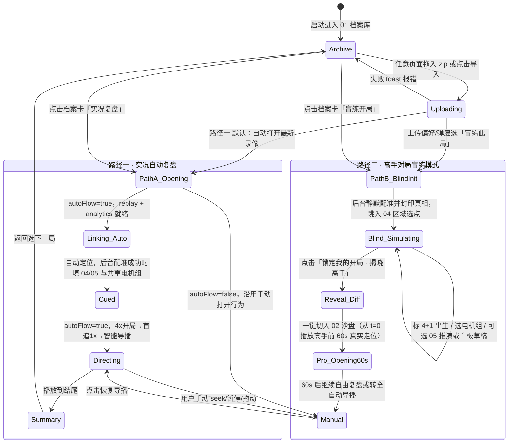
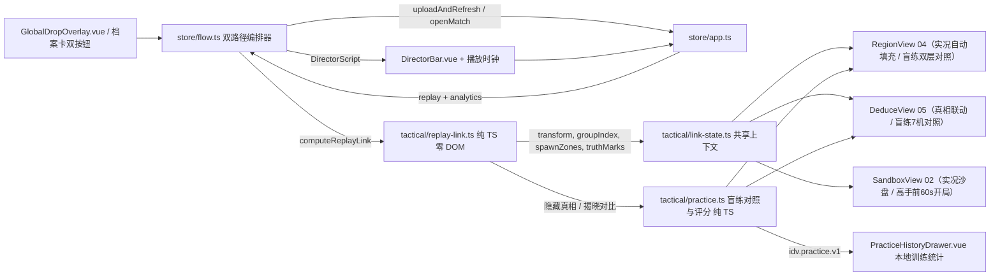
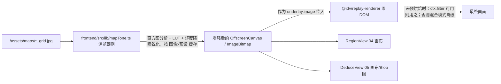
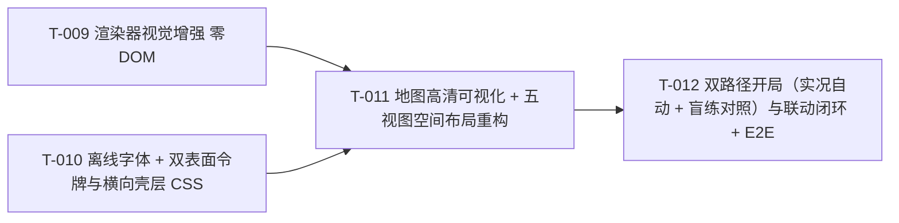

# PLAN.md — Phase 3：双路径开局 · 空间布局重构 · 地图高清可视化 · 庄园哥特美学与离线真字体

> 作者：Chief Architect · `codex:gpt-6.2-sol high`，沿用 `chief-v3` 的代码与直方图诊断及 `chief-v4` 的 Phase 3 工程规划，纳入用户批准的五张 Manor Dossier 概念图（§6）。
> 状态：**五屏视觉方向已确认，工程方案待审核**。当前交付为根目录 `PLAN.md` 的规划修订。
> 基线：`d47dde0`（Phase 1 + Phase 2 / T-001..T-008R 全部 PASS）
> 硬约束（沿用 [Workflow/PLAN.md](file:///i:/geminiiii/idv-tactical-replay/Workflow/PLAN.md)）：
> 1. `packages/replay-renderer/src/**` 保持 **零 DOM**（`"lib": ["ES2022"]`，不引用 `window/document/Image/HTMLCanvasElement`），保证能移植到微信小程序 `<canvas type="2d">`；
> 2. **零外网请求**：不加 `https://` 字体、CDN 或图片，所有资源都由 Vite 打进 `frontend/dist/assets/` 或放在 `frontend/public/assets/`；
> 3. 不破坏 `Replay2DPayload` / `MatchAnalyticsPayload` / REST 契约和 Phase 1/2 已有能力。

---

## 0. 一页摘要（给审核人）

| 用户痛点与核心诉求 | 根因（已用代码、直方图与实机截图核对） | Phase 3 方案 | 量化目标 |
|---|---|---|---|
| **开局应有两条核心路径，且流程需自动化** | ① 上传后只提示点击下方卡片，不自动进沙盘，打开录像停在 `t=0` 暂停；② `04/05` 与录像彻底割裂，出生点与 7 机全靠手点；③ **缺少「先自己模拟开局，再看高手怎么选」的盲练对照模式** | **双路径开局 + 流程编排器 `store/flow.ts` + 录像配准 `replay-link.ts` + 盲练引擎 `practice.ts`**：<br>• **路径一 · 实况自动复盘**：上传/点击录像 → 自动进 `02 沙盘` → 开局加速/首追定位 + 智能导播，后台自动配准填好 `04/05`；<br>• **路径二 · 高手对局盲练模式**：遮蔽高手真相 → 用户先在 `04`（及可选 `05`/白板）标出自己的 4+1 出生与封禁/7 机 → 一键锁定揭晓同屏双层对照与评分点评 → 直达 `02 沙盘` 看高手开局前 60 秒真实拉扯与抓人路线，成绩写入本地历史 | 路径一从冷启动到「首追 + 04 已填 + 05 7/7」：**约 25 次点击降到 ≤ 2 次**；路径二盲练揭晓配准精确率 ≥ 6/7，且锁定前零剧透 |
| **页面布局挤压，地图不够大、局部 UI 占高过多** | 实测 `1440×900` 截图：`02 沙盘` 被顶栏 `52px` + 外边距 `46px` + 玩家条 `46px` + 工具栏 `42px` + 时间轴 `78px` + 间距 `30px` 吃掉 **294px 高度**，右栏 `360px` 下半屏大片空黑，**地图面积仅占屏幕 43.3%**（`1366×768` 仅 39.3%）；`04/05` 顶栏 `<select>` 与 9 地图 pill 双行重复，加底部两行区标，吃掉 **262px 高度** | **统一 `50px` 深石板与黄铜顶栏（§5）**，五个步骤按钮和标题徽记、对局/模式、自动流转、须知及设置同列。移除左侧轨道，将 `#steps` 的按钮移至顶栏并保留选择器。`02` 用悬浮 HUD、分段工具栏和 `48px` 时间轴，`04/05` 用单行地图控件，三页共用可收起的暖羊皮纸卷宗 | 移除侧栏单项返还 **`+68px…+84px`**。三档桌面地图宽度为 **75.1%–77.8%**（展开）和 **98.3%–98.5%**（收起）。`02` 默认地图高 **84.4%–88.9%**，`04/05` 为 **85.7%–89.8%**（§5.3） |
| **五屏需共用庄园档案风格** | 历史界面以深色卡片为主，已批准的概念图给出纸面与地图的内容层级 | **§5.4、§6、§7.4–7.5** 以五张概念图为 Phase 3 官方视觉基准：石板地图舞台配右侧羊皮纸卷宗，档案库用纸卡和蜡封，对比分析用全宽纸页 | 五屏按同一顶栏与双表面令牌验收，使用真实应用数据与本地底图 |
| **地图太暗，看不清建筑与点位** | ① 9 张 `*_grid.jpg` 原图亮度中位数仅 34–73/255（军工厂 p5..p95 仅 21..55）；② 渲染器以 `opacity 0.55` 叠在 `#0b0a09` 上，屏幕中位数仅 23–45/255；③ 地标太小（密码机 r=9px）无光晕；④ 网格几乎隐形 | **两层地图色调管线**（浏览器侧直方图自动色阶 + Gamma + 轻度降噪锐化缓存 + 渲染器零 DOM 兜底）+ **三档一键预设**（默认「清晰战术」`opacity 0.95`）+ 高对比光晕矢量地标 | 「清晰战术」档地图亮度**中位数 ≥ 100、p95 ≥ 190**；1× 下地标 ≥ 20px 且带暗光晕 |
| **UI 与字体显得廉价** | ① 删掉 Google Fonts 后 `--serif` 在 Windows 回退到 SimSun 宋体，且与 YaHei 混用；② 9–11px 小字 41 处；③ 中文字距 `3–5px` 显松散；④ `--dim` 对比度仅 3.0:1；⑤ 32 处 `border:1px` + 17 个独立按钮框 | **自托管 SIL OFL 离线字体**（思源宋体 Noto Serif SC + Cinzel + Cormorant Garamond + 霞鹜文楷）配合石板浅字与羊皮纸深墨，黄铜统一导航、分段控件与章节标题 | 正文 ≥ 13px、最小 ≥ 12px，常规文字对比度 ≥ 4.5:1，羊皮纸主墨 > 11:1。运行时**零外网请求**、零 SimSun |

**拆分（§9）**：`T-009` 渲染器视觉增强（零 DOM）∥ `T-010` 离线字体与设计系统/壳层基础 → `T-011` 地图高清可视化与五视图空间布局重构 → `T-012` 双路径开局（实况自动复盘 + 高手盲练对照）与联动闭环 + E2E。

**需要您拍板的决策点见 §11**（共 8 项，均已给出推荐默认值）。

---

## 1. 现状深度诊断

### 1.1 流程割裂与开局练习闭环缺失

依据：实机截图 `01_archive / 02_sandbox_decluttered / 04_region / 05_deduce` 及现有源码。

| # | 现象（截图 / 交互） | 代码根因 | 影响 |
|---|---|---|---|
| F1 | 档案库「投递录像」上传成功后只显示提示文字，用户还需在卡片网格中找新档案再点开 | [ArchiveView.vue#L77-L79](file:///i:/geminiiii/idv-tactical-replay/frontend/src/components/ArchiveView.vue#L77-L79)：`uploadMsg = '已导入 N 场对局，点击下方档案即可打开'`，不调用 `openMatch` | 多 1 次寻找 + 1 次点击 |
| F2 | 顶栏「导入录像」仅在恰好 1 场时自动打开；多场时先退回档案库 | [App.vue#L53-L57](file:///i:/geminiiii/idv-tactical-replay/frontend/src/App.vue#L53-L57) | 两处上传入口行为不一致 |
| F3 | 拖拽只绑在档案库左上角虚线框；拖到页面其他区域会被浏览器直接下载/打开 | `@drop` 只绑在 `#dropZone`（[ArchiveView.vue#L128-L136](file:///i:/geminiiii/idv-tactical-replay/frontend/src/components/ArchiveView.vue#L128-L136)），`window` 未拦截 | 02–05 页面无法拖入且易误触发 |
| F4 | 打开录像后停在 `00:00` 且暂停，右栏「0/7 密码机」，地图仅显出生点 | [store/app.ts#L140-L146](file:///i:/geminiiii/idv-tactical-replay/frontend/src/store/app.ts#L140-L146)：`store.t = opts.t ?? 0`，未使用已有字段 `analytics.hunter_metrics.first_chase_t`（如唐人街 #126 为 `18.535s`） | 需手动播放并拖轴找首追 |
| F5 | 缺少智能导播：8 分钟录像需全程手动找亮点 | `chase_segments / markers / phases` 仅画时间轴三角，未驱动自动播放剧本 | 复盘效率低 |
| F6 | `04 区域选点` / `05 密码机推演` 顶栏显示当前战术地图及「战术演练」，例如「军工厂 · 战术演练」。文案缺少已打开录像的对局模式与联动状态 | [App.vue#L32-L36](file:///i:/geminiiii/idv-tactical-replay/frontend/src/App.vue#L32-L36) 读取 `activeMapId` 组合文案；`RegionView` / `DeduceView` 不读取 `store.replay` | 录像与选点/推演工具完全断层 |
| F7 | 04 的 4+1 出生区域、第几组密码机和 05 的 7 台机全靠逐一手动点选 | 录像中已有真实出生点（`trajectories` `t≈0`）与本局真实 7 台机（`entities.ciphers`，7 份本地缓存均 `nciph=7` 且含稳定 `pos_id`） | 每局复盘多点 15–20 次 |
| F8 | **缺失「盲练开局 → 揭晓对照高手」路径** | 现有 04/05 只是无答案的静态工具，无法关联某场高手录像先遮蔽真相做练习，更无法同屏比对用户选点 vs 高手实际开局 | 用户想拿高手录像当题库训练开局思路时无从下手 |
| F9 | 04 选满 4 个求生者后不自动切到监管者；选完监管者算出封禁机后无下一步引导 | [RegionView.vue#L127-L159](file:///i:/geminiiii/idv-tactical-replay/frontend/src/components/RegionView.vue#L127-L159) 第 5 次点击才报错；无 CTA | 打断心流，不知下一步去向 |
| F10 | 「第 N 组密码机」在 04、02 白板（[SandboxView.vue#L120](file:///i:/geminiiii/idv-tactical-replay/frontend/src/components/SandboxView.vue#L120) 且不持久化）、05 三处各自维护 | 缺乏单一数据源 | 同一件事要切 3 遍 |
| F11 | `03 对比分析` 未选对局时仅置灰，未解释原因 | `canEnterStep(3)` 只返回布尔值 | 交互生硬 |

### 1.2 地图又暗又糊：量化根因

**实测数据**（PIL 读取 `frontend/public/assets/maps/*_grid.jpg` 灰度直方图）：

| 地图 | 尺寸 | 原图亮度中位数 | 原图 p5..p95 | 屏幕实际中位数 ≈ 0.55·L + 0.45·10 | 屏幕实际 p95 |
|---|---|---|---|---|---|
| 军工厂 | 1231×1076 | 39 | 21..55 | **26** | 35 |
| 湖景村 | 977×842 | 34 | 20..61 | **23** | 38 |
| 红教堂 | 1028×968 | 38 | 21..65 | **25** | 40 |
| 圣心医院 | 1195×1107 | 43 | 24..66 | **28** | 41 |
| 永眠镇 | 1390×1063 | 43 | 10..69 | **28** | 42 |
| 唐人街 | 1224×1065 | 51 | 26..96 | **33** | 57 |
| 月亮河公园 | 1474×858 | 56 | 29..95 | **35** | 57 |
| 里奥的回忆 | 1220×1072 | 61 | 22..126 | **38** | 74 |
| 不归林 | 1186×1149 | 73 | 41..109 | **45** | 64 |

结论：**整张地图被压扁在 0–255 的 16–74 极暗区间**（约 6%–29% 亮度），由 6 项叠加导致：
1. 原图本身是低动态范围夜景航拍（军工厂仅 34 个有效灰阶），单靠调高 opacity 救不回来，必须直方图色阶拉伸 + Gamma 校正。
2. [renderer.ts#L149](file:///i:/geminiiii/idv-tactical-replay/packages/replay-renderer/src/renderer.ts#L149) 与 [SandboxView.vue#L97](file:///i:/geminiiii/idv-tactical-replay/frontend/src/components/SandboxView.vue#L97) 默认 `opacity: 0.55` 叠在 `#0b0a09` 黑底上，亮度直接腰斩。
3. 04（[RegionView.vue#L383-L388](file:///i:/geminiiii/idv-tactical-replay/frontend/src/components/RegionView.vue#L383-L388)）和 05 未对底图提亮，叠加半透明区域块后更显浑浊。
4. 网格线 `#3a332a`、`alpha 0.35`（[renderer.ts#L341-L343](file:///i:/geminiiii/idv-tactical-replay/packages/replay-renderer/src/renderer.ts#L341-L343)）叠在亮度 26 的图上几乎不可见。
5. 地标图元过小且无暗光晕（密码机 r=9px 填 `#1a1714` 与地图同色、进度字 9px；椅子 7px 三角；门 16×9px + 8px 字；地窖 r=7px）。
6. Canvas 字体回退到 SimSun，且字体加载完成后未触发 Canvas 重绘。

### 1.3 页面空间占比与布局诊断（基于实机截图与 CSS 实测）

逐像素核对 [manor.css](file:///i:/geminiiii/idv-tactical-replay/frontend/src/styles/manor.css)、[pil-views.css](file:///i:/geminiiii/idv-tactical-replay/frontend/src/styles/pil-views.css) 以及实机截图 `01_archive.png / 02_sandbox_decluttered.png / 04_region.png / 05_deduce.png`，暴露出严重的空间错配：

| 问题位置 | 实测尺寸与代码出处 | 截图里的真实后果（以 `1440×900` / `1366×768` 计） |
|---|---|---|
| **外壳固定损耗过大** | `#bar: 52px`、`#app` 首列与 `#steps: 84px`、`.step` 四周内边距 `22px 26px 24px`（[manor.css#L42-L73](file:///i:/geminiiii/idv-tactical-replay/frontend/src/styles/manor.css#L42-L73)）。`#steps` 是 `#bar` 的同级节点（[App.vue#L139-L175](file:///i:/geminiiii/idv-tactical-replay/frontend/src/App.vue#L139-L175)），`pil-views.css` 另有纵栏滚动和按钮内边距覆盖（[pil-views.css#L6-L16](file:///i:/geminiiii/idv-tactical-replay/frontend/src/styles/pil-views.css#L6-L16)） | 业务内容尚未排版就已扣除 **98px 垂直高度 + 136px 水平宽度** |
| **`02 沙盘` 顶部两整行纯垂直浪费** | `#strip`（玩家状态条 ~`46px`）+ `#toolbar`（17 个带框按钮 ~`42px`）+ 间距 `20px` = **108px**（[manor.css#L125-L158](file:///i:/geminiiii/idv-tactical-replay/frontend/src/styles/manor.css#L125-L158)） | 截图 `02_sandbox_decluttered.png` 中地图顶部被两层重型黑栏死死压低，且 `#toolbar` 17 个独立边框极度分散视线 |
| **`02 沙盘` 底部时间轴偏胖** | `#transport`（控制行 + 快捷键大段文字 + 滑块 ~`78px` + `10px` gap = **88px**，[manor.css#L176-L185](file:///i:/geminiiii/idv-tactical-replay/frontend/src/styles/manor.css#L176-L185)） | 快捷键说明书硬塞在时间轴里拉高行高；合计垂直非地图消耗高达 **294px**，`1366×768` 下地图仅剩 **474px（61.7% 高）** |
| **`02 沙盘` 右栏过厚且大量留黑** | `#rightCol: clamp(340px, 25vw, 440px)` + `18px` gap（[manor.css#L119](file:///i:/geminiiii/idv-tactical-replay/frontend/src/styles/manor.css#L119)） | 截图 `02_sandbox_decluttered.png` 中右栏抢走 360px 宽度，但**右栏下半截超过 55% 是纯黑空白**；同时不可收起，导致地图区仅占 **64.3% 宽 × 67.3% 高 = 43.3% 屏幕面积**（`1366×768` 仅 **39.3%**） |
| **`04 / 05` 顶部地图选择器双行重复** | `.pil-topbar` 内同时放了 `<select> 军工厂 v` **和** 第二整行 9 张地图 pill（~`80px` + `10px` gap，[pil-views.css#L49-L94](file:///i:/geminiiii/idv-tactical-replay/frontend/src/styles/pil-views.css#L49-L94)） | 截图 `04_region.png` / `05_deduce.png` 中顶栏多占整整一行；且 `.pil-right` 宽达 `clamp(350px, 27vw, 460px)`（`389px`），地图外框左右出现大块黑柱 |
| **`04` 底部图例 + 9 区按钮双行堆叠** | `.pil-action-bar`（~`64px` + `10px` gap，[pil-views.css#L268-L349](file:///i:/geminiiii/idv-tactical-replay/frontend/src/styles/pil-views.css#L268-L349)） | 与直接点地图 9 区高度重复；叠加顶栏后 04 垂直损耗达 **262px**，地图高占比仅 65.9%–70.9% |
| **`05` 右栏三张长卡纵向互挤** | 推演依据 + 候选布局 + 规律速查同列展开（[pil-views.css#L33-L46](file:///i:/geminiiii/idv-tactical-replay/frontend/src/styles/pil-views.css#L33-L46)） | 截图 `05_deduce.png` 最底部「规律速查」被裁切出视口，用户需频繁滚右栏 |
| **`01 档案库` 首屏大黑框与徽章折行** | `#dropZone` 占据整格首卡大黑框；卡片右上徽章无数量/宽控 | 截图 `01_archive.png` 第 6 卡「自定义模式 / 自退 / 预置档案」被迫折成两行遮挡画面 |

Phase 3 将 `#steps` 嵌入 `50px` 高的 `#bar`，外壳改为单列。按同一页边距、卷宗宽度和间隙比较，移除旧草案的 `68px` 侧栏或当前源码的 `84px` 侧栏，地图分别直接增加 **68px** 或 **84px**。在 `1366×768`、`1440×900`、`1920×1080` 下，`02/04/05` 展开卷宗宽度分别为 **1029 / 1082 / 1494px**，收起为 **1346 / 1416 / 1888px**（§5.3）。

### 1.4 UI 与字体：为什么显得廉价

| # | 根因 | 证据 |
|---|---|---|
| U1 | **字体回退到 SimSun** | [manor.css#L12-L13](file:///i:/geminiiii/idv-tactical-replay/frontend/src/styles/manor.css#L12-L13) `--serif` 落到 Windows 点阵宋体 SimSun；`--hand` 落到楷体；T-008R 删掉 Google Fonts 后未补本地字体 |
| U2 | **两套字体混用** | `body` 用 `Microsoft YaHei`，组件大量用 `var(--serif)`（SimSun），同一行宋体与雅黑混排 |
| U3 | **字号过小** | `--f1: 12px`；9–11px 极小字散落 41 处；Canvas 内 8–10px |
| U4 | **中文字距过松** | `.k{letter-spacing:5px}`、`.gbtn{letter-spacing:3px}`，汉字字字分离 |
| U5 | **对比度不足** | `--dim:#655c4e` 对 `#0b0a09` ≈ **3.0:1**（低于 WCAG AA 4.5:1） |
| U6 | **框套框** | `.fr::before` 叠加 32 处 `border:1px`，02 工具栏 17 个独立方框噪音极高 |
| U7 | **层级扁平** | 卡片 `rgba(16,14,12,.84)` 与 `#0b0a09` 几乎同色，缺乏「面」的明暗层次 |
| U8 | **罗马数字字形** | 侧栏 `Ⅰ Ⅱ Ⅲ Ⅳ Ⅴ` 为 Unicode 码位（U+2160..），Cinzel 不含这些码位，需改拉丁字母 `I II III IV V` |

---

## 2. 设计原则

1. **双路径并行，不互相打架**：实况自动复盘追求「极速直达、零废话」，盲练模式追求「严格遮蔽、揭晓震撼、对比直观」；两者共用同一套配准与战术状态底座，随时可从盲练揭晓一键切入实况沙盘。
2. **地图至上，克制留白**：地图视口是本产品唯一的核心舞台；非高频控件收进分段条、角标悬浮 HUD 或可收起抽屉，绝不用多行厚栏把地图压成邮票。
3. **自动在前，手动优先**：每个自动动作都可见（toast/徽章）、可撤销，且用 `source` 标记保护用户的手动编辑不被静默覆盖。
4. **单一数据源**：地图 ID、当前电机组、出生区域、真实 7 机统一托管于共享战术上下文，02/04/05 同步联动。
5. **零 DOM 渲染器 + 零外网**：渲染器包保持纯 TS 可移植至微信小程序 `<canvas type="2d">`；所有字体与素材 100% 本地打包。
6. **可度量验收**：点击次数、配准准确率、视口面积占比、亮度直方图、文字对比度、外网请求数全部纳入自动化测试。

---

## 3. 支柱一：双路径开局与端到端全自动流转引擎

### 3.1 开局两条核心路径与总体状态机

整个应用围绕用户的两种核心使用意图设计为**两条一等公民入口路径**，在 `01 档案库` 卡片、全局拖拽上传弹层及顶栏上下文中清晰分流：

- **路径一 · 实况自动复盘（上传 / 点击录像 → 自动进沙盘）**：面向「快速看这局怎么打」的复盘场景。拖入 `.zip` 或点击档案卡「实况复盘」，零停顿直达 `02 战术沙盘`，自动开局加速定位首追并启动智能导播，同时后台自动完成坐标配准，静默填好 `04 区域选点` 与 `05 密码机推演` 真相。
- **路径二 · 高手对局盲练模式（先自己模拟开局，再对比高手选择）**：面向「拿高手录像练开局意识」的训练场景。在档案库对任意高手录像点击「盲练开局」（或上传高手录像时选择盲练）：
  1. **阶段 1（遮蔽真相）**：严格隐藏高手真实出生位置、`trajectories` 走位与本局真实 7 台密码机真相，仅展示地图底图与本局双方阵容/禁用元数据；用户先自己在 `04 区域选点` 标出预测的 4+1 出生区域与封禁密码机（可选连带 `05 密码机推演` 或 `02` 白板草稿画出开局转点/抓人思路），点击「锁定我的开局」；
  2. **阶段 2（揭晓与同屏对照）**：一键揭晓高手真实开局，在地图上用双层对比标记同屏呈现「你的出生选点 vs 高手实际出生点（来自 `t = 0..3s` 轨迹）」「你的 7 机/封禁判断 vs 本局实际 7 机」，右侧输出重合度/偏差评分点评并记入本地训练历史，底部一键切入 `02 战术沙盘` 观看高手开局前 60 秒真实拉扯、躲避与抓人路线！



### 3.2 新模块与数据流



| 新文件 | 职责 | 零 DOM？ |
|---|---|---|
| `frontend/src/store/flow.ts` | 双路径编排：偏好设置、上传后自动打开、路径一自动定位/导播/总结、路径二盲练状态机（`idle / blind / revealed / pro-opening`）、防剧透守卫、跨步骤 CTA | 否（用 `localStorage` / `window`） |
| `frontend/src/tactical/replay-link.ts` | 录像世界坐标 ↔ 庄园地图像素配准、匹配电机组、推断 `t=0..3s` 出生区域与精确像素落点、生成 04/05 真值 | **是**（纳入纯度审计） |
| `frontend/src/tactical/practice.ts` | 盲练模式纯函数引擎：比对用户 4+1 选区 vs 高手实际出生点（区命中率 + 偏移米数）、比对预测电机组/封禁机/7 机 vs 真相、计算综合评分与战术偏差点评、管理 `idv.practice.v1` 历史记录序列化与汇总统计 | **是**（注入 `StorageLike`） |
| `frontend/src/tactical/link-state.ts` | 共享战术上下文（每张地图一份：`groupIndex / source / matchId / spawn / truth`），存入 `idv.pil.v2.link` | 是（注入 `StorageLike`） |
| `frontend/src/tactical/director.ts` | 由 `analytics + markers` 生成 `DirectorScript`（纯函数），含「前 60 秒高手开局专场」分段模式 | 是 |
| `frontend/src/components/flow/GlobalDropOverlay.vue` | 全局拖拽遮罩 + 上传进度（支持上传后默认进路径一或按住 Shift/勾选进路径二盲练） | 否 |
| `frontend/src/components/flow/FlowToast.vue` | 自动动作提示（带「撤销」） | 否 |
| `frontend/src/components/flow/DirectorBar.vue` | 紧凑悬浮导播条：当前片段说明、快进/聚焦状态、恢复/退出 | 否 |
| `frontend/src/components/flow/PracticeHud.vue` | 盲练模式顶部轻量状态带（显示「盲练中 · 真相已封印」/「已揭晓 · 得分 86」及一键锁定/重练按钮） | 否 |
| `frontend/src/components/flow/PracticeRevealCard.vue` | 揭晓后的右侧对照点评卡（4+1 命中明细、封禁/7 机对比、偏差点评、一键看高手前 60s CTA） | 否 |
| `frontend/src/components/flow/PracticeHistoryDrawer.vue` | 盲练历史成绩与多局高手录像汇总统计抽屉（按地图/监管者统计命中率） | 否 |
| `frontend/src/components/flow/NextStepCta.vue` | 地图底部悬浮主 CTA | 否 |
| `frontend/src/components/flow/SummaryBanner.vue` | 播完后的复盘总结横幅 | 否 |

### 3.3 偏好开关 `FlowPrefs`（持久化）

```ts
// frontend/src/store/flow.ts
export interface FlowPrefs {
  autoFlow: boolean;                              // 总开关，默认 true；false 恢复 Phase 2 手动行为
  defaultEntryPath: 'sandbox' | 'practice' | 'ask'; // 上传后的默认路径，默认 'sandbox'（见 §11 Q1）
  autoOpenAfterUpload: boolean;                   // 默认 true
  cue: 'opening-fast' | 'first-chase' | 'none';   // 默认 'opening-fast'（见 §11 Q2）
  director: boolean;                              // 默认 true
  autoLinkTactics: boolean;                       // 路径一下录像自动填 04/05/02，默认 true
  endAction: 'banner' | 'auto-analytics' | 'off'; // 默认 'banner'
  regionAutoSwitchCamp: boolean;                  // 04 选满 4 求生者自动切监管者，默认 true
  visualPreset: 'clarity' | 'original' | 'dossier'; // 默认 'clarity'
  rightDrawerCollapsed: boolean;                  // 沙盘/选点/推演右栏折叠记忆，默认 false
}
// localStorage key: 'idv.flow.v1'；带 sanitize
```

- 顶栏右侧统一收敛为一个紧凑胶囊按钮「⚙ 自动 / 手动」，点击展开配置菜单；
- **深链接优先**：`#m=<id>&s=<n>&t=<sec>` 带 `t` 时直接按 `t` 定位；支持 `&mode=practice` 直接以盲练模式打开指定高手录像，支持 `&auto=0` 关闭本次自动流转。

### 3.4 路径一：实况自动复盘（上传 / 点击 → 自动进沙盘 → 导播与联动）

1. **全局拖拽**：`App.vue` 挂载 `GlobalDropOverlay`，在 `window` 上拦截 `dragenter/dragover/dragleave/drop`，任意页面均可直接拖入一个或多个 `.zip`，彻底防止浏览器误下载/打开文件。
2. **统一上传入口 `flow.importFiles(files, { entryPath? })`**：档案库投递区、顶栏「导入录像」、全局拖拽全走同一入口。
   - 上传 1 场：按 `entryPath ?? prefs.defaultEntryPath` 立即进入 `02 战术沙盘`（路径一）或 `04 盲练开局`（路径二）；
   - 上传多场：默认自动打开 `save_time_float` 最新的一场，toast 提示「另 N 场已入库 · [查看档案库]」。
3. **自动定位（`cue`）**：
   - `'opening-fast'`（推荐默认）：从 `t = 0` 开始以 **4× 快进播放开局**，到 `first_chase_t - 3s` 自动平滑降至 **1×** 并跟随监管者，兼顾开局出生点直观印象与快速切入首追；
   - `'first-chase'`：直接 `seek(first_chase_t - 3)` 并聚焦监管者；
   - 降级链：`first_chase_t` → `chase_segments[0].start_t` → `markers[0].t` → `0`。
4. **智能导播（Smart Director，`tactical/director.ts`）**：
   ```ts
   export interface DirectorSegment {
     start: number; end: number;
     mode: 'fast' | 'focus' | 'beat' | 'opening60';
     speed: 1 | 2 | 4;
     followUid: number | null;
     caption: string; // 例："追击 · 汽修二班秦晓萌 · 8.4s"
   }
   ```
   - `chase_segments` 前后各扩 2s 合并为 `focus`（1× 跟随监管）；
   - 关键事件（`cipher_done / first_chair / eliminate / doors_powered / gate_open / hit_attack / rescue_complete`）生成 `beat`，脉冲高亮并停顿 1.2s（可关）；
   - 无事件空档以 4× `fast` 跳过；
   - 用户任何手动 `seek / pause / 拖轴 / 方向键` 立即挂起导播为 `suspended`（**永不抢控制权**），顶部悬浮 `DirectorBar` 显示「导播已暂停 · ▶ 恢复」；
   - 播至结尾显示 `SummaryBanner`（「进入 03 对比分析 / 04 选点复盘（已自动填充）/ 继续自由查看」）。

### 3.5 路径二：高手对局盲练模式（自己模拟开局 → 同屏对照高手 → 看前 60 秒实况）

这是 Phase 3 重点打造的第二条核心入口，让每一份高手录像都能瞬间变成一道可交互、可评分、可回看实况的「开局战术练习题」：

#### 3.5.1 触发入口
- **`01 档案库` 卡片双入口**：每张录像卡片底部提供清晰的双动作条：主按钮 **「实况复盘」**（走路径一进 02）、次按钮 **「盲练开局」**（走路径二进 04 遮蔽态）；卡片角标若该局已练过，显示历史最高分徽章（如 `盲练 88 分`）。
- **上传时可选**：全局拖拽遮罩底部提供轻量勾选框「导入后进入盲练模式（默认实况复盘）」。
- **`04 区域选点` 内快捷开启**：顶栏提供「🎯 盲练高手录像」下拉入口，直接从当前地图的高手录像中随机或指定抽一局开始盲练。

#### 3.5.2 阶段 1：遮蔽真相（`mode = 'blind'`）
1. 后台加载 `replay` 与 `analytics` 并静默运行 `computeReplayLink()`，将高手真实数据（`proSpawnZones`、`proExactPoints`、`proGroupIndex`、`proTruthMarks`、`proLockCipher`）保存在 `flow.practiceSession.sealedTruth` 中，**不写入** `04/05` 公开视图，也**不渲染**任何轨迹或电机进度。
2. **防剧透守卫**：
   - `04` 右卷宗顶部挂载 `PracticeHud`，卷宗收起时在地图边缘显示紧凑状态：「🎯 高手盲练中 · 真相已封印｜地图：唐人街｜阵容：歌剧演员 vs 先知/佣兵/古董商/囚徒（若元数据可用）｜已完成：求生 2/4 · 监管 0/1」；
   - 若用户未锁定前点顶栏 `02 沙盘` 或 `03 对比分析`，弹出轻量确认框「当前处于盲练遮蔽阶段，查看实况将提前揭晓真相」→「继续盲练 / 放弃并看真相」（唯独允许切入 `02 沙盘` 的**纯净白板草稿模式**画自己的转点/抓人预演线，不加载录像实体）。
3. **用户自主模拟开局**：
   - 在 `04 区域选点` 自由点选预测的 4 个求生者出生区域 + 1 个监管者出生区域（选满 4 求生者自动切到监管者阵营）+ 切换预测的密码机刷点组（系统实时算出用户的预测封禁机）；
   - （可选进阶）点击「顺带推演 7 机 → 05」在 `05 密码机推演` 中根据常见开局刷机逻辑标记自己预判的 7 台密码机；
   - （可选进阶）在 `02 白板草稿` 上手绘自己预想的开局拉扯/抓人路线（保存在 `practiceSession.draftShapes`）。
4. 当用户选满至少 1 个求生区与 1 个监管区（推荐 4+1）时，地图底部黄铜主按钮亮起：**「🔒 锁定我的开局 · 揭晓高手选择」**。

#### 3.5.3 阶段 2：揭晓与同屏对照（`mode = 'revealed'`）
点击锁定后，纯函数引擎 `evaluatePractice(userAttempt, sealedTruth)` 即时计算对照结果，地图与右栏同步切换为**同屏双层对照视图**：

1. **地图双层对照渲染（`04 区域选点` 画布）**：
   - **底层（你的模拟）**：保持用户的 4+1 区域半透明色块与实线角标；
   - **叠加层（高手真相，来自 `t = 0..3s` 真实轨迹）**：
     - 4 名求生者与 1 名监管者的**真实精确出生落点**以高对比发光圆点 + 角色名胶囊直接画在地图坐标上；
     - 高手真实出生区域外圈加粗虚线金/红边框；
     - **直观对比符号**：选区完全命中显示绿色 **`✓ 命中`** 徽章；选偏的区域用带箭头的虚线将「你的预测区中心」连到「高手真实出生点」，在线段中点标注偏差距离（例如 `偏差 1 区 · 28.4m`）；
     - 同时对比「你算出的封禁密码机」与「高手实际出生对应的封禁密码机」（命中标金色 `封禁一致 ✓`，不一致则双标「你判 / 实际」）。
2. **`05 密码机推演` 7 机对照（若用户参与了 05 推演或切到 05 查看）**：
   - 7 台实际刷出的密码机叠加高亮金框，逐台显示 `✓ 命中`（用户标有且实际有）、`✗ 漏判`（实际有但未标/标无）、`! 误判`（用户标有但实际无），顶部汇总「7 机判断准确度：6/7 · 本局实际为第 2 组」。
3. **右侧栏 `PracticeRevealCard`（量化评分与偏差点评）**：
   ```ts
   export interface PracticeScoreResult {
     totalScore: number;              // 0..100（求生选区 40 + 监管选区 30 + 封禁机/电机组 30）
     survivorHits: number;            // 0..4
     hunterHit: boolean;
     hunterOffsetMeters: number;      // 监管预测区中心到实际出生点的距离（米）
     groupExactMatch: boolean;
     lockCipherMatch: boolean;
     cipherHitCount: number | null;   // 若用户做了 05 推演，0..7
     insights: string[];              // 自动生成的 2-3 条中文战术偏差点评
   }
   ```
   - 示例点评：「监管者实际出生在【5 中场】（与你预测一致 ✓）；求生者命中 3/4，4 号位高手选择了更稳健的【7 右上正门废墟】避开近点；封禁密码机准确命中【废料区】。」
   - 附带对比开关：「同时显示 / 仅看我的 / 仅看高手」。
4. **一键切入高手开局前 60 秒实况**：
   - 地图底部与右侧点评卡提供黄铜主 CTA：**「▶ 进入 02 沙盘 · 看高手开局前 60 秒」**；
   - 点击后直达 `02 战术沙盘`，自动从 `t = 0.0s` 以 **1× 速度**（可手动调速）播放高手开局前 60 秒的真实拉扯、躲避、修机选择与首追抓人路线，时间轴 `00:00–01:00` 区间以金色高亮带标出，并在 `01:00`（或首追结束）处弹出轻量提示「高手开局 60 秒回放完毕 · [继续看整局] [返回对比卡片] [再来一局盲练]」；
   - 若用户在阶段 1 画了白板草稿线，沙盘默认叠加半透明「我的开局草稿」图层（可一键开关），实现**个人思路 vs 高手真实走位**的终极同屏复盘！

#### 3.5.4 本地练习历史与多局复盘统计
- 每次锁定揭晓自动追加写入 `localStorage`（key：`idv.practice.v1`，带 schema 校验与最多 200 条滚动保留）；
- `PracticeHistoryDrawer.vue`（从 `01 档案库` 顶栏「📊 盲练记录」或 `PracticeRevealCard` 打开）按**总平均分、分地图命中率、监管/求生分别命中率、封禁机准确率**聚合展示，点击任意历史记录可一键回看该局的对照详情或再练一次。

### 3.6 录像 ↔ 区域选点 ↔ 推演 ↔ 白板：自动联动配准算法（共享底座）

路径一的「自动填充 04/05」与路径二的「揭晓高手真实开局」共享同一套零 DOM 坐标配准引擎 `frontend/src/tactical/replay-link.ts`。

#### 3.6.1 坐标配准：带尺度先验的 2D 二面体 RANSAC + 最小二乘精修
现状：录像 `world.map_underlay.world_rect` 是按静态实体包围盒加 8% 边距近似拟合的，不可直接用于 3×3 区域判定；庄园数据（`MAPS_DATA[mapId]`）的电机点 `ciphers[].location` 与区域网格 `mapsZonesRelative` 均为地图像素坐标。

- **输入**：`P` = 录像 7 台电机 `(x, z)`；`Q` = 庄园地图全部候选电机像素坐标 `location (px, py)`（12–16 个）；尺度先验 `s₀ = 1 / uPerPx`（`uPerPx = widthM / mapSize[0] · WORLD_UNITS_PER_METER`）。
- **候选变换**：`T(p) = s · D · p + t`，`D` ∈ 8 种二面体（0/90/180/270° × 镜像）。
- **RANSAC**：对每种 `D` 枚举锚点对 `(pᵢ, qₐ)`（约 8 × 7 × 16 ≈ 900 个假设），在 `s = s₀` 下解 `t`，统计落入 `τ = 3% · mapSize[0]` 内的内点数。
- **精修与匹配**：锁定最优 `D` 在内点上做 Umeyama 最小二乘精修 `s, t`（校验 `|s / s₀ − 1| < 15%`）；在 `T(P)` 与 `Q` 间做最小代价一一对应得到 `matchedCipherIds[7]`。
- **置信度与电机组**：`confidence = 内点数 / 7 × exp(−平均残差 / τ)`，**≥ 0.8 才允许自动填充或盲练揭晓**（低置信度提示手动校准）；`groupIndex = argmax_g |cipherCombinations[g] ∩ matchedCipherIds|`（7/7 精确、6/7 近似）。
- **交叉校验**：用 `pos_id % 100` 固化 7 份本地缓存录像的回归夹具 `replay-link.fixtures.json`，配准冲突时告警。耗时 `< 5ms`。

```ts
export interface ReplayLinkResult {
  mapId: PilMapId;
  transform: { s: number; dihedral: 0|1|2|3|4|5|6|7; tx: number; ty: number };
  confidence: number;
  matchedCipherIds: string[];
  groupIndex: number | null;
  groupMatch: 'exact' | 'approx' | 'none';
  spawn: {
    survivorZones: number[];
    hunterZone: number | null;
    perPlayer: Array<{
      uid: number; camp: 1|2; name: string;
      zone: number; px: number; py: number; edgeDistPx: number;
    }>; // px/py 供路径二揭晓绘制高手精确出生落点
  };
  truthMarks: DeduceMarksState;
  matchId: string;
}
```

#### 3.6.2 出生区域推断
1. 每名玩家取 `t ∈ [0, 3s]` 内首个有效样本（复用渲染器 `samplePlayerAtTime`；若缺失向后延展至 5s）；
2. 用 `T` 将 `(x, z)` 映射为地图像素 `(px, py)` 与相对坐标，落入 `mapsZonesRelative[mapId]` 的 3×3 九宫格并计算距边界距离 `edgeDistPx`；
3. 求生者区域去重（不足 4 区时按实填并提示）；`edgeDistPx < 2% · mapSize[0]` 标「贴边 ❓」。

#### 3.6.3 自动填充与不覆盖保护（路径一）
`link-state.ts` 记录每图 `{ source: 'manual' | 'replay' | 'deduce' | 'practice', matchId?, at }`：
- 当前 `04/05` 为空或 `source='replay'`：路径一打开录像后直接填充，toast 提示「已按本局录像填充 04/05 · 撤销」；
- 当前为 `source='manual'`：**绝不静默覆盖**，顶部给提示条「检测到本局录像：唐人街 第 2 组 · [用录像覆盖] [忽略]」；
- 顶栏上下文在 04/05 联动时显示「唐人街 · 录像联动 · 第 2 组」或「唐人街 · 高手盲练中」，彻底消灭「战术演练」断层（修复 F6）。

### 3.7 视图内自动化与双路径操作效率对比

- **04 区域选点**：选满 4 求生者自动切「监管者选点」；选定监管者后底部浮出 `NextStepCta`（路径一：「推演密码机 / 同步到沙盘」；路径二：「🔒 锁定我的开局 · 揭晓高手」）；电机组切换实时同步 02/05。
- **05 密码机推演**：收敛到唯一 7/7 布局时亮起金色「已锁定第 N 组」并浮出同步 CTA；未唯一时计算**信息增益最大**的下一台待确认电机，用呼吸光圈引导点击；支持顶部开关切换「录像真值 / 自我推演」。

**路径一点击次数对比（冷启动 → 看到首追 + 04 已填 + 05 达到 7/7）**

| 步骤 | Phase 2 现状 | Phase 3（路径一 autoFlow） |
|---|---|---|
| 导入并打开录像 | 选文件 + 确认 + 找卡片点击（4） | 拖入窗口任意位置自动进 02（0 次点击） |
| 找到首追 | 点播放 + 拖轴（2–4） | 自动 4× 开局→首追 1× 播放（0 次） |
| 04 区域选点 | 切页 + 切组 + 4 求生 + 切阵营 + 1 监管（7–11） | 点顶栏 04（1），已自动填好 |
| 05 密码机推演 | 切页 + 逐台标有/无（8–11） | 点 CTA 或顶栏 05（1），已 7/7 |
| **合计** | **约 20–26 次** | **≤ 2 次** |

**路径二盲练闭环（档案库选高手录像 → 模拟开局 → 同屏揭晓 → 看高手前 60s）**：点「盲练开局」(1) → 点选 4+1 区域 (5) → 点「锁定并揭晓」(1) → 查看同屏双层对照与评分 → 点「看高手前 60 秒」(1)，全链路流畅无折返。

### 3.8 手动模式兼容承诺
`autoFlow = false` 时恢复 Phase 2 手动行为（不自动播放、不导播、不自动填 04/05）。保留 Vitest / E2E 的行为覆盖，壳层结构断言按 §9 更新。

---

## 4. 支柱二：地图高清高亮可视化系统

### 4.1 两层色调处理管线（宿主预烘焙 + 渲染器零 DOM 兜底）



**第一层：`frontend/src/lib/mapTone.ts`（浏览器侧）**
- 灰度直方图求 `p1, p50, p99`；
- 线性拉伸 `x = clamp((v − p1) / (p99 − p1))`；
- 自适应 Gamma `γ = clamp(log(0.47) / log((p50 − p1) / (p99 − p1)), 0.55, 1.0)`，把每张图的中位亮度统一拉升到 ~0.47；
- 输出范围 `outLo = 0.06`、`outHi = 0.92`，避免死黑与过曝，保留羊皮纸温润质感；
- **窄动态范围防噪**：当 `p99 − p1 < 48`（如军工厂）时，75% 拉伸 + 25% 纯 Gamma 混合，并施加一次 3×3 轻度平滑降噪防止 JPEG 块效应放大；饱和度 ×1.08 + 轻度反锐化（0.35）；
- 示例：军工厂屏幕中位数由 **26 → ~120**，p95 由 **35 → ~199**；单张 1.2MP 图仅烘焙一次（30–80ms），后续渲染零开销。

**第二层：`packages/replay-renderer`（零 DOM 可移植参数）**
- `UnderlayConfig` 新增可选字段：`opacity` 默认 `0.55 → 0.92`、`tone?: { brightness?; contrast?; saturation? } | null`、`backing?: string | null`（地图托板底色，如 `#2b251d`）；
- `Canvas2DContextLike` 新增可选成员：`filter?`、`globalCompositeOperation?`、`strokeText?`、`shadowColor?`、`shadowBlur?`；
- `drawUnderlay()`：① 若有 `backing` 先填地图托板色，与画布外深石板底形成「灯下桌面」聚焦；② 宿主未预烘焙且 `tone` 非空时，有 `ctx.filter` 用之并恢复 `'none'`，无 `ctx.filter`（小程序/旧内核）用 `screen` + `soft-light` 混合模式降级。

### 4.2 三档一键视觉预设（02 / 04 / 05 全局同步）

由渲染器导出纯数据 `VISUAL_PRESETS`，前端共用 `MapPresetSwitch.vue`，持久化至 `idv.flow.v1.visualPreset`：

| 参数 | **清晰战术（推荐默认）** | 原图高清 | 暗金档案 |
|---|---|---|---|
| 宿主 LUT | 自动色阶 + Gamma + 降噪/锐化 | 无（原图） | Gamma 0.9 + 棕褐微调（15% `#c9a25f`） |
| `underlay.opacity` | `0.95` | `1.0` | `0.72` |
| `backing` | `#2b251d`（暖石板托板） | `#1c1915` | `#0b0a09` |
| 画布外底色 | `#14110e` | `#14110e` | `#0b0a09` |
| 网格 | 细线 `rgba(240,230,210,.14)`；每 5 格主线 `rgba(216,179,106,.32)` | 细线 `.10` | 现状 |
| 地标 | 大号光晕徽章，`glyphScale 1.35` | `glyphScale 1.2` | 现状尺寸 + 光晕 |
| 04 区域色块 | 求生 `rgba(143,176,220,.16)` + 2px 实线；监管 `rgba(208,96,110,.20)` | 仅描边不填色 | 现状 |

### 4.3 地标可读性升级（「一眼分清哪里是什么」）

统一采用「**暗色外光晕**（`#0b0a09` α=0.85，线宽 +3px）+ **高对比主体**」，文字一律 `strokeText` 3px 暗描边（无 `strokeText` 时 8 向 1px 偏移退化）。

| 地标 | 现状 | 清晰战术 |
|---|---|---|
| 密码机 | r=9 暗底，9px 字 | r=12（随缩放 0.85–1.6×），奶油底 `#f0e6d2` + 2px 金环 `#d8b36a` + 3.5px 进度弧；修机中呼吸金光；修完实心金 + ✓ |
| 木板 | 3px 金线 | 6px 暗衬 + 3.5px `#f2c96b`；已放：8px 暗衬 + 5px `#e0626f`；已踩：灰 ✕ |
| 窗户 | 1.5px 暗框 | 4px 暗衬 + 2px 冰蓝 `#bfe0ff`；封窗中心红点 |
| 狂欢之椅 | 7px 三角 | 10px 椅子徽章；上椅红底 + 32×5 进度条；地下室虚线红框 + `B1` 光晕标 |
| 地下室入口 | 无 | 新增楼梯符号 + 「地下室」标签（`map.basements` 或按地下室椅推断） |
| 逃生门 / 地窖 / 箱子 | 16×9 / r=7 / 8×6 | 门 26×16（12px「门」，通电发光）；地窖 r=11 实心 `#10202e` + 冰蓝环；箱子 10×8 加暗衬 |
| 玩家名牌 | 10px | 12px 光晕胶囊；监管 `#e0626f` / 求生 `#8fb3e0` |
| 04 区域与盲练双层标 | 1px 暗线，11px 区名 | 4px 暗衬 + 2px `rgba(240,230,210,.55)`；13px 暗底胶囊区名；盲练揭晓层高亮真实出生坐标点与偏差虚线 |
| 05 电机标记 | 30px 无光晕 | 36px 加 2px 暗光晕；推断有/无改用虚线环；信息增益最高待测机加呼吸金环 |

渲染器保留原 `MANOR_DOSSIER_PALETTE`（兼容既有单测），新增导出 `MANOR_CLARITY_PALETTE` 与 `RendererOptions.visualPreset / glyphScale`。

### 4.4 01 / 02 / 04 / 05 统一与字体就绪重绘
- 02/04/05 统一接入 `getEnhancedMap(url, preset)`；01 档案卡缩略图施加 `filter: brightness(1.35) contrast(1.12) saturate(1.05)` + 底部渐变护字；
- `lib/typography.ts` 导出 `whenFontsReady()`，所有 Canvas 视图在字体加载完成后主动重绘一次，彻底杜绝 Canvas 残留宋体。

---

## 5. 支柱三：五屏布局与视口预算

### 5.1 统一 50px 庄园顶栏

| 壳层区域 | Phase 3 结构与预算 | 行为 |
|---|---|---|
| `#app` / `#stage` | 外壳单列，`grid-template-rows: 50px minmax(0, 1fr)` | 地图舞台占满主内容区。概念图的纸签与边角装饰可用框内 CSS 表现，占用布局宽度为 `0px` |
| `#bar` | 单行 **`50px`**，含底部黄铜发丝线。顺序为标题徽记与返回、`#ctx` 对局/地图与模式、`#steps`、自动流转与操作区 | 须知、设置、导入保留入口。长上下文和上传文案在本组内省略或放进菜单，完整内容可在提示和可访问名称读取 |
| `#steps` | 移入 `#bar` 的横向 `nav`，五个按钮按 **01 档案库、02 战术沙盘、03 对比分析、04 区域选点、05 密码机推演** 排列 | 活跃项用暖黄铜铭牌、`.on` 与 `aria-current="step"`。保留 `.done` 和 `.lock`，无对局时 03 保持守卫和锁定原因，01/02/04/05 可直接进入。保留 `#steps button[data-step="1"]` 至 `[data-step="5"]`，维持 Playwright 和 Vitest 选择器兼容 |
| 地图页 `.step` | 上下各 `8px`，左右各 `p`（§5.3） | 框边、悬浮条和卷宗拉手画在已预算的框内。清理 `manor.css` 与 `pil-views.css` 的纵栏宽度、滚动、边线及侧向激活条 |
| 内容页 `.step` | 上下各 `14px`、左右各 `18px`（桌面） | 01 同时显示纸卡网格与导入纸页，03 为完整通栏纸页 |
| 地图页右卷宗 | `--right-col-w: clamp(296px, 22.5vw, 384px)`，展开间隙 `10px` | 展开为独立滚动的羊皮纸面，收起时宽度与间隙同时归零。右上边缘的黄铜拉手和快捷键 `]` 可恢复，拉手悬浮在画布边缘，避让地图控件 |

顶栏桌面预算（CSS px）使用与地图页相同的左右 `p`。标题徽记区含返回及其组内间距，步骤预算含标签、图标和组内间距。组间 `3 × 12px = 36px`；对局与模式区使用可用余量，长文可省略，宽屏余量作为弹性留白。

| 视口 | 顶栏内宽 `W−2p` | 标题区 | 五阶段导航 | 自动流转、导入、须知/设置 | 组间距 | 对局/模式与弹性余量 |
|---|---:|---:|---:|---:|---:|---:|
| 1366×768 | 1346 | 220 | 610 | 248 | 36 | 232 |
| 1440×900 | 1416 | 220 | 610 | 248 | 36 | 302 |
| 1920×1080 | 1888 | 220 | 610 | 248 | 36 | 774 |

### 5.2 `02 战术沙盘` 地图、HUD 和时间轴

```text
┌────────────────────────────────────────────────────────────────────────────┐
│ #bar 50px   标题徽记 · 对局/模式   #steps 01 02 03 04 05   自动 · 须知/设置 │
├───────────────────────────────────────────────────┬────────────────────────┤
│ 悬浮玩家 HUD、工具分段条和图例                     │ 暖羊皮纸战术卷宗       │
│                                                   │ 实时战况 · 工具 · 事件│
│ 俯视地图、布点、轨迹                              │ 计时、密码机、目标检视│
│                                                   │ 近期关键事件          │
├───────────────────────────────────────────────────┤                        │
│ #transport 48px · 播放控制与事件标记              │ 黄铜收起拉手          │
└───────────────────────────────────────────────────┴────────────────────────┘
```

1. **玩家 HUD `#strip`** 悬浮于地图左上角（`top: 10px; left: 10px`），显示 30px 监管者头像和四名求生者状态胶囊，展开可读完整姓名与状态，点击保留跟随，支持折叠。短图例或比例尺贴画布边缘，详细图例可从须知展开。
2. **工具条 `#toolbar`** 在顶部右侧安全区内占 `34px`，四组为视角、楼层、工具、视图与操作。保留检视、放置、绘制、测算、范围、动画六种工具，以及图层与预设、撤销、清空、存档、导出 PNG。空间不足时收起次级操作并折叠玩家 HUD，保证两组不重叠。`fitToView` 为画布上方留 `topSafeInset: 48px`。悬浮默认布局从原有两条独立行及间隙归还 **108px** 高度。
3. **时间轴 `#transport`** 固定 `48px`，与地图间隔 `6px`。保留播放/暂停、±5 秒、倍速、当前/总时间、标记与拖动，快捷键说明放在 `?` 提示。导播状态与下一步 CTA 可悬浮在底部安全区。
4. **右侧 `#rightCol`** 用「实时战况 / 战术工具 / 事件流」三页签。默认实时战况显示当前时间、七机进度、椅子摘要、选中目标和最近五条可跳时的关键事件。展开与收起按 §5.1 共享预算，白板与实况保留相同壳层。

### 5.3 三档桌面像素预算与测量口径

- 地图左列外框使用 border-box。以视口宽高 `W × H` 计，展开宽度 = `W − 2p − F − 10`，收起宽度 = `W − 2p`。`p` 按 §5.5 断点设为 `10 / 12 / 16px`，右卷宗宽 `F = clamp(296px, 22.5vw, 384px)`，预算表四舍五入到整 CSS px。画布和装饰边线使用同一外框预算。
- `02` 地图高 = `H − (50 + 16 + 48 + 6) = H − 120`。`04/05` 地图高 = `H − (50 + 16 + 38 + 6) = H − 110`，其中 `38px` 是唯一地图控制行，图例和 CTA 放在地图内或卷宗中。
- 比例以 CSS 布局视口为分母。面积为地图舞台外框面积，底图仍按配准和相机规则等比绘制。右栏展开与收起均测量地图外框，悬浮件、位图比例、相机缩放和 DPR 不参与预算。

| 视口 | 右卷宗 | 横向扣减 | 地图宽及视口占比 | 02 地图高及视口占比 | 02 舞台面积占比 | 04/05 地图高及视口占比 | 04/05 舞台面积占比 |
|---|---|---|---|---|---|---|---|
| 1366×768 | 展开 | 20 + 307 + 10 = 337px | **1029px · 75.3%** | 648px · 84.4% | 63.6% | 658px · 85.7% | 64.5% |
| 1366×768 | 收起 | 20px | **1346px · 98.5%** | 648px · 84.4% | 83.1% | 658px · 85.7% | 84.4% |
| 1440×900 | 展开 | 24 + 324 + 10 = 358px | **1082px · 75.1%** | 780px · 86.7% | 65.1% | 790px · 87.8% | 66.0% |
| 1440×900 | 收起 | 24px | **1416px · 98.3%** | 780px · 86.7% | 85.2% | 790px · 87.8% | 86.3% |
| 1920×1080 | 展开 | 32 + 384 + 10 = 426px | **1494px · 77.8%** | 960px · 88.9% | 69.2% | 970px · 89.8% | 69.9% |
| 1920×1080 | 收起 | 32px | **1888px · 98.3%** | 960px · 88.9% | 87.4% | 970px · 89.8% | 88.3% |

侧栏移除量按相同页边距、间隙和卷宗宽度单独核算。下表每格顺序为「卷宗展开 / 收起」。

| 视口 | 若保留旧草案 68px 侧栏 | 若保留源码 84px 侧栏 | 侧栏归零后的地图宽 | 单独归还给地图 |
|---|---:|---:|---:|---:|
| 1366×768 | 961 / 1278px | 945 / 1262px | 1029 / 1346px | +68 / +84px |
| 1440×900 | 1014 / 1348px | 998 / 1332px | 1082 / 1416px | +68 / +84px |
| 1920×1080 | 1426 / 1820px | 1410 / 1804px | 1494 / 1888px | +68 / +84px |

若审核选择 §11 Q4 的贴顶工具条备选，独立控制行 `28px` 加间距 `4px`，三档 `02` 高度分别为 `616 / 748 / 928px`（`80.2% / 83.1% / 85.9%`）。宽度预算相同。

### 5.4 五屏布局蓝图

| 视图 | 主区域 | 卷宗与交互 |
|---|---|---|
| **01 档案库** | 石板框内先排标题、档案计数与单行 `44px` 筛选，盲练记录从筛选区进入。下方为 **2×N 暖羊皮纸卡网格**。每卡左侧提亮地图缩略图，右侧墨色地图名、阵营、时长和日期。胜利用绯红蜡封，失败用靛蓝蜡封。胜负文字随徽章展示，其余元数据进入正文紧凑排列 | 右侧独立羊皮纸 `.zip` 导入卷宗，保留 `#dropZone`、拖放和选择文件，并就地反馈解析状态。卡底固定一深一浅的 **实况复盘 / 盲练开局** 双按钮（高 `32px`），分别接 §3 两条路径 |
| **02 战术沙盘** | 大幅提亮地图，保留建筑与板窗边缘、路线、罗盘和尺度。HUD 与图例轻量悬浮，底部保留 `48px` 时间轴（§5.2） | 可收起的右侧羊皮纸卷宗为 **实时战况 / 战术工具 / 事件流**。唐人街概念图的案情层次映射至现有实时战况和检视能力 |
| **03 对比分析** | 外层石板框，内为全宽羊皮纸。顶部三张黄铜标题阶段卡横排（开局博弈、中期运营、开门战/残局，卡高 ≤ `112px`），随后是通栏全局 KPI 行 | 底部扣除栏间距后按 **70% / 30%** 分配：左侧距离折线与追击时段图（共用时间轴），右侧求生者破译对比表与实色墨条。图例、轴单位和对照列按数据绘制，宽表自身横滚并固定首列 |
| **04 区域选点** | 亮地图上绘制 **3×3 黄铜发丝线**与区名、蓝色「求」和绯红「监」、发光「封禁密码机」及虚线路径。九宫格是概念基准，各图保留已有校准和特例区划。单行 `38px` 工具位集成 9 图选择、密码机组、阵营、预设、重置和盲练抽题，区按钮可按需展开 | 右卷宗按 **封禁密码机战报 → 职业选手 vs 我的选点 → 7 机距离表** 排列。封禁展示位置、状态和规则支持的持续时间。揭晓后 `PracticeRevealCard` 展示双侧选点、评分与偏差，表格标题注明距离对应的选点。遮蔽态仅展示用户预测与进度，高手行、真值与真值路线由 §3 守卫。主要 CTA 可在画布底部或卷宗底部触达 |
| **05 密码机推演** | 地图用带编号的徽章区分 **必刷 / 有 / 推断有 / 无**，未确认保留未知态。细三角/链线从实际推演步骤生成，当前链路可高亮。单行 `38px` 工具位含地图选择、预设、重置和可用的真值切换 | 右卷宗从上到下排 **黄铜进度计 → 编号推演步骤 → 候选布局矩阵 → 底部状态图例**。唯一布局确认时显示 `7/7`，其余状态按引擎结果显示进度、候选、冲突或待测提示。规律速查可折叠，保留候选预览及同步 CTA |

### 5.5 响应式断点与防挤压

| CSS 视口宽度 | 壳层与地图页 | 档案与图表 |
|---|---|---|
| `≥ 1600px` | 每侧 `p = 16px`。横向卷宗按 `F` 计算，至 `384px` 封顶 | 档案双列，分析保留 `70:30` |
| `1440–1599px` | 每侧 `p = 12px`，地图与卷宗并排 | 档案双列，分析保留 `70:30` |
| `1366–1439px` | 每侧 `p = 10px`，五阶段全称与必要操作位于 `50px` 同一行 | 档案双列，纸卡元数据收紧，双入口完整可用 |
| `1100–1365px` | 每侧 `p = 10px`。卷宗可覆盖式展开以保留地图可视面积，次要操作进顶栏菜单 | 档案双列，横向空间不足时缩短次要元数据。图表和表格各自伸缩，表格内滚 |
| `< 1100px` | 同一顶栏保留五个真实步骤按钮，窄屏优先压缩标题和操作区，步骤区可横向滚动，焦点自动滚入。地图高至少 `58dvh`，卷宗下置或以抽屉展开 | 导入卷宗移到列表下方，卡片可由两列降为一列。图表和表格上下排列，主 CTA 粘底或悬浮 |

地图主列使用 `minmax(0, 1fr)`，各滚动容器使用 `min-width: 0; min-height: 0`。卷宗主体独立纵滚，表格在其外层横滚，页签、拉手和底部主操作保持可访问，顶栏不换行。

## 6. Phase 3 官方视觉参考图索引

用户已批准以下五张 Manor Dossier 概念图。原图位于 `I:\geminiiii\ui-concepts\`，尺寸均为 `1672×941`。按下表顺序对照 §5.4 的页面结构与 §7.4–7.5 的材质、排版和状态表达。

| 顺序 | 官方概念图 | 视觉核对重点 |
|---|---|---|
| 01 档案库 | [stage01-archive.png](../ui-concepts/stage01-archive.png) | 石板标题区、双列纸卡、地图缩略图与双色蜡封，卡底双路径按钮，右侧独立 `.zip` 投递纸页 |
| 02 战术沙盘 | [chinatown-tactical-dossier.png](../ui-concepts/chinatown-tactical-dossier.png) | 亮地图与冷暖路线、比例尺和紧凑图例、右侧纸面案情层次。工程页按 §5.2 接入时间轴与三页签 |
| 03 对比分析 | [stage03-analytics.png](../ui-concepts/stage03-analytics.png) | 通栏纸页、三阶段黄铜卡、通栏 KPI、左距离/追击图和右侧破译对比表 |
| 04 区域选点 | [stage04-region.png](../ui-concepts/stage04-region.png) | 军工厂九宫格、双阵营令牌、封禁发光与虚线路径、高手与我的选点对照及距离表 |
| 05 密码机推演 | [stage05-deduce.png](../ui-concepts/stage05-deduce.png) | 圣心医院编号徽章与规则连线、黄铜进度计、推演步骤、候选布局矩阵和状态图例 |

五屏使用 §5.1 的统一导航标签和实际业务数据。概念图里的地图、对局时长、名单、距离及推演数值仅作构图示意，运行时地图仍取本地校准资产，左边缘纸签和装饰收进外框。截图对照使用已批准的 PNG 原图，应用构建资源沿用本地地图、字体和 CSS。

---

## 7. 支柱四：庄园哥特美学与离线真字体

### 7.1 字体选型与版权（100% SIL OFL 开源，零商用侵权风险）

| 用途 | 字体 | 许可 | npm 包（已核实可用） | 说明 |
|---|---|---|---|---|
| 中文标题和正文主体 | **思源宋体 Noto Serif SC** | SIL OFL 1.1 | `@fontsource/noto-serif-sc@5.3.1`（或可变版） | 雕版衬线，契合第五人格维多利亚探案档案气质；引入 `500`（正文）/ `700`（标题）两字重 |
| 英文标题、数字、徽记 | **Cinzel** | SIL OFL 1.1 | `@fontsource/cinzel@5.3.0`（约 0.33MB） | 用于英文标题、徽记及导航 `01–05`。需要罗马数字的装饰用拉丁字母（修复 U8） |
| 计时数字、英文副标 | **Cormorant Garamond** | SIL OFL 1.1 | `@fontsource/cormorant-garamond` | 维多利亚旧式衬线；配 `lining-nums tabular-nums`（T-010 实测 `tnum` 支持，不支持则回落 Noto Serif SC 等宽数字） |
| 手记、批注、空状态 | **霞鹜文楷 LXGW WenKai Screen** | SIL OFL 1.1 | `lxgw-wenkai-webfont@1.7.0`（仅 Screen Regular） | 替代缺字的 `--hand: Ma Shan Zheng`，用于空态、阶段标题、推演手记、盲练偏差点评 |

> [!IMPORTANT]
> **关于「第五人格同款字体」**：游戏客户端内定制字库属于商用授权字体，**不得**随本项目打包分发。默认方案采用上述 4 款 SIL OFL 开源字体还原维多利亚哥特探案档案气质；若用户个人持有商用字库授权，可通过 §7.3 在本机 IndexedDB 中导入，绝不进入仓库与构建产物。

### 7.2 自托管打包管线（零外网）

- 新增 `frontend/src/styles/fonts.css`，由 `main.ts` 首位引入：
  ```css
  @import '@fontsource/noto-serif-sc/500.css';
  @import '@fontsource/noto-serif-sc/700.css';
  @import '@fontsource/cinzel/600.css';
  @import '@fontsource/cinzel/700.css';
  @import '@fontsource/cormorant-garamond/500.css';
  @import '@fontsource/cormorant-garamond/600.css';
  @import 'lxgw-wenkai-webfont/lxgw-wenkai-screen.css';
  ```
- Vite 将 `.woff2` 按 `unicode-range` 切片打包至 `dist/assets/`，浏览器仅按需加载当前字符切片（运行时约 0.5–1.5MB，100% 本地）；可选方案 B（`scripts/subset-fonts.py` 子集化至 ~2MB，见 §11 Q7）。
- 新字体栈（替换 [manor.css#L12-L13](file:///i:/geminiiii/idv-tactical-replay/frontend/src/styles/manor.css#L12-L13)，彻底移除 `SimSun / STSong / YaHei` 混用）：
  ```css
  --font-cjk:   "IDV Custom Display", "Noto Serif SC", "Source Han Serif SC", "Songti SC", serif;
  --font-latin: "Cinzel", "Cormorant Garamond", "Noto Serif SC", serif;
  --font-num:   "Cormorant Garamond", "Noto Serif SC", serif;
  --font-hand:  "LXGW WenKai Screen", "LXGW WenKai", "Noto Serif SC", serif;
  --serif: var(--font-cjk);
  --hand:  var(--font-hand);
  body { font: 400 var(--f-body)/1.65 var(--font-cjk); }
  ```
- Canvas 侧统一从 `frontend/src/lib/typography.ts` 引用 `CANVAS_FONT_CJK` / `CANVAS_FONT_LATIN`。

### 7.3 用户自定义字体（可选，零网络、零 404）
设置面板提供「导入自定义标题字体（`.ttf / .otf / .woff2`）」→ 存入本机 IndexedDB（`idv.fonts`）→ 启动时 `new FontFace('IDV Custom Display', buf)` 注册至 `--font-cjk` 首位，可随时移除；不在 `public/` 留空链接以免控制台 404。

### 7.4 双表面设计令牌

**深石板与黄铜**用于顶栏、外框和地图舞台。**暖羊皮纸与深墨**用于 02/04/05 右卷宗、01 纸卡与导入页、03 通栏分析纸页。纸面容器定义自己的文字、控件和分隔线配色。

| 表面与用途 | 令牌 | Phase 3 值 | 使用说明 |
|---|---|---|---|
| 外框与导航 | `--bg` / `--surface-1` | `#12100e` / `#181512` | 深庄园石板。画布边框与顶部暮色保留明暗层次，底图颜色由 §4 的预设控制 |
| 深色控件与交互 | `--surface-2` / `--surface-3` / `--hud-glass` | `#221d17` / `#2b241c` / `rgba(18,15,12,.80)` 配合 `blur(6px)` | 控件底、悬停底和地图 HUD。HUD 遇亮图时实测文字对比度，需时加深文字衬底 |
| 黄铜边线 | `--gold` / `--gold-d` / `--line` / `--line2` | `#d8b36a` / `#a88a52` / `rgba(216,179,106,.16)` / `rgba(216,179,106,.32)` | 抗锯齿发丝线、选中态和地图边框。焦点线使用足够实度以保持可见 |
| 石板文字 | `--text` / `--muted` / `--dim` | `#f0e6d2` / `#b9ab8f` / `#8a7d66` | 在 `#181512` 上分别约 **14.68:1 / 8.04:1 / 4.51:1**。较亮暗面用前两档 |
| 地图叠加颜色 | `--red-l` / `--blue` / `--ok` | `#d0606e` / `#8fb0dc` / `#5fc9a0` | 监管、求生、命中/有刷。以暗衬、描边、形状和文字区分，沿用 §4.3 的地标可读性措施 |
| 暖羊皮纸 | `--paper` / `--paper-2` / `--paper-edge` | **`#ebe0c8` / `#e1d2b3` / `#c7b48e`** | 主纸面、次层或表格底、纸边。细颗粒用低不透明度的 CSS 重复渐变，边缘用径向渐变轻微做旧，纹理使用零外部 URL |
| 纸上文字 | `--ink` / `--ink-muted` | **`#241b13` / `#5a4835`** | 咖啡黑主墨和棕褐副墨。主墨在两种纸底分别约 **12.91:1 / 11.34:1**，副墨约 **6.64:1 / 5.83:1** |
| 纸上阵营与数据 | `--ink-red` / `--ink-blue` | **`#8e2733` / `#2f547e`** | 勃艮第红监管、石板靛蓝求生。两种纸底上的最低对比度分别约 **5.66:1 / 5.23:1**，折线和条形另有角色标记 |
| 拉丝黄铜标题带 | `--ribbon-bg` / `--ribbon-ink` | `linear-gradient(100deg, #52351f, #6c4b2d)` / `#fff1db` | 黄铜细亮边与棕铜内底。用于章节、阶段卡和推演标题，浅字对最亮内底约 **7.03:1** |
| 档案蜡封 | `--wax-win` / `--wax-lose` / `--wax-ink` | `#76212e` / `#244264` / `#fff1db` | 绯红胜利、靛蓝失败。内外双环加短绶带，徽章中心保留胜负文字 |
| 字阶与字距 | `--f-body` / `--f-sm` / `--f-h3` / `--f-h2` / `--f-h1` | `14px`（密集区 `13px`） / `12px` / `16px` / `22px` / `28px` | 正文、标题与小标保持紧凑中文排版，正文及导航字距不超过 `0.06em`，表格数字等宽 |
| 面板深度 | `--shadow-1` | `0 8px 24px rgba(0,0,0,.45), inset 0 1px 0 rgba(240,230,210,.04)` | 用于一级框和纸页边缘，正文区域保持平整 |

设计对比度按所列实色计算，最终截图以纹理、透明度和交互状态合成后的可读性为准。纸边、纹理和阴影放在正文之外或避开行文区域，主墨对实际纸面保持 **> 11:1**，普通文字保持 **≥ 4.5:1**。亮地图由 §4 的 `clarity` LUT 提升可辨识度，保留并适度提亮原图暖灯、墙面和屋檐轮廓，沿用既定色阶、裁剪与缓存。地图托板与外框分别由渲染预设和壳层控制，羊皮纸滤镜只作用于纸面。

### 7.5 组件与状态

1. **顶栏与地图框**使用一根抗锯齿黄铜发丝线。活跃导航用黄铜铭牌和深墨字，状态、键盘焦点和锁定原因有明确视觉反馈。悬浮工具用 `.seg` 聚合为至多四组，罗盘、尺度和高频图例贴近地图边缘。
2. **纸页与章节**用薄纸边、轻微暗角和拉丝铜 `--ribbon-bg`。标题带用于真实业务区块，二级内容用细分隔线、浅纸面或六像素圆角，`.fr::before` 留在一级框。表格用墨色表头和局部行强调，长内容在组件内滚动。
3. **纸卡与按钮**沿用 `.btn-primary` 和 `.btn-ghost` 的角色区分。档案卡的「实况复盘」用深铜底浅字，「盲练开局」用浅铜底深字。双按钮边线清晰，颜色、名称和焦点共同标示动作。胜负蜡封置于信息侧，缩略图和按钮各占独立区域。
4. **纸面战报**用 Cormorant Garamond 等宽数字呈现 `02` 主计时（32–34px）、密码机进度环及 `04` 盲练评分，必要时使用 §7.1 的等宽回退。分析页曲线和破译条沿用同一角色映射，追击窗口用低透明度背景和文字图例。
5. **战术徽章**沿用真实坐标绘制。04 以「求 / 监」字面配合蓝/绯红令牌，封禁机用金色光晕和锁形，真实和预测用线型与文字区分。05 **必刷**用金环与锁形，**有**用深绿实环，**推断有**用黄铜虚环，**无**用暖灰环，保留推断无的虚线提示和未知态。图上和纸面状态使用同一编号与文字，连线与候选矩阵从规则引擎取值。

### 7.6 装饰与插画资产分级制造规范（复杂用 Codex 生图，简单自研矢量）

> 原则：**复杂度高、带光影/建筑笔触的视觉元素交由 `codex` CLI（`image_gen`）生成并本地落盘至 `frontend/public/assets/dossier/`；结构简单、强调锐利边缘与动态状态的 UI 部件全部由前端自研纯 SVG + CSS 实现**，严禁手绘粗糙占位图，也避免把简单的几何控件做成固定尺寸位图。

| 分类 | 具体资产 | 制作方式 | 用途与位置 |
|---|---|---|---|
| **复杂艺术插画 / 肌理**<br>（Codex CLI `image_gen` 本地生成） | `manor-header-crest.png` | `image_gen` 生成暗金夜景欧利蒂丝庄园剪影与暖窗微光横幅 | `50px` 顶栏背景左中过渡装饰纹 |
| **复杂艺术插画 / 肌理** | `parchment-etching-gate.png` | `image_gen` 生成透明底棕色钢笔手绘庄园铁门线稿 | `01` 导入卷宗与 `02` 右卷宗底部手记插画 |
| **复杂艺术插画 / 肌理** | `analytics-header-sketch.png` | `image_gen` 生成透明底怀旧钢笔建筑街景线描横幅 | `03 对比分析` 羊皮纸抬头淡雅背景插画 |
| **复杂艺术插画 / 肌理** | `parchment-tile.png` | `image_gen` 生成无缝暖羊皮纸 `#ebe0c8` 细腻纸纹平铺底图 | 所有羊皮纸卷宗/纸卡表面（替代生硬噪点滤镜） |
| **桌面侦探写实陈设**<br>（Codex CLI 透明底生图） | `desk-fountain-pen.png`、`desk-pocket-watch.png`、`desk-vintage-postcard.png` | `image_gen` 生成透明底深蓝鎏金钢笔、古铜罗马字怀表、怀旧老照片明信片 | `pointer-events: none` 轻巧点缀于卷宗边角与外框安全边距（`< 1366px` 自动淡隐退避，绝不遮挡按钮与地图区） |
| **简单几何 / 交互部件**<br>（纯 SVG + CSS 自研） | 卷宗顶部黄铜燕尾夹 (`BinderClip`) | 内联 SVG 渐变 + 高光描边（< 2KB） | 右卷宗顶部装订装饰，永不模糊 |
| **简单几何 / 交互部件** | 绯红「胜利」/ 靛蓝「失败」火漆蜡封 | 双环锯齿火漆 SVG + 绶带 + 居中墨字 | `01 档案库` 卡片胜负状态 |
| **简单几何 / 交互部件** | 四角维多利亚黄铜雕花与发丝分隔线 | 单个 corner SVG 镜像四次 + `--ribbon-bg` 渐变 | 一级外框与章节标题丝带 |
| **简单几何 / 交互部件** | 导航图标、7 机进度环、`必刷` 锁标 | 轻量 `<svg>` 图标与 CSS 动态组件 | 实时响应对局/推演状态 |

---

## 8. 兼容性与约束核对

视口、配准、纸纹及兼容风险见 §10。

| 约束 | 保障机制 |
|---|---|
| 渲染器零 DOM | `packages/replay-renderer` 新增字段全为可选纯数据；`filter / globalCompositeOperation / strokeText` 运行时特性检测；`purity.test.ts` 与 `typecheck:dom-compat` 必过；`mapTone.ts` 位于 `frontend/src/lib/` |
| 微信小程序 `<canvas type="2d">` | 宿主预烘焙为主、混合模式降级为兜底；单测覆盖无 `filter` / 无 `strokeText` 的 mock ctx |
| 零外网请求 | 字体来自 npm 打入 dist，自定义字体走本机 IndexedDB；E2E 监听全部 Playwright 请求，**断言 0 条非 `127.0.0.1/localhost` 请求** |
| Canvas 导出 PNG 安全 | 增强底图在同源 canvas / OffscreenCanvas / `blob:` 生成，绝不污染画布 |
| 盲练防剧透与存储安全 | `sealedTruth` 仅存内存会话，不泄漏至 DOM 未揭晓区；`idv.practice.v1` 带 schema sanitize 与异常回落，不阻塞主流程 |
| 契约与旧测试兼容 | 保留后端、REST、`Replay2DPayload`、`MatchAnalyticsPayload` 与 `MANOR_DOSSIER_PALETTE`。横向导航沿用步骤选择器、深链接和进退守卫。以 `autoFlow=false` 覆盖 Phase 2 手动行为，现有 Vitest 与全栈 E2E 行为断言继续有效 |

---

## 9. 实施拆分（Task Packets 预览）



### T-009 · `@idv/replay-renderer` 视觉增强（零 DOM）
- **写入范围（独占）**：`packages/replay-renderer/**`
- **内容**：
  - `UnderlayConfig.tone / backing`，默认 `opacity 0.92`；`Canvas2DContextLike` 可选成员；
  - `drawUnderlay` 三条路径（托板 / `ctx.filter` / 混合降级）；
  - `VISUAL_PRESETS`、`MANOR_CLARITY_PALETTE`、`RendererOptions.visualPreset / glyphScale`、`topSafeInset` 相机适配留白支持（确保悬浮 HUD 不遮挡默认视野中的地图）；
  - 网格主次线、§4.3 全部地标光晕徽章、文字描边退化、地下室入口图元。
- **验收**：`npm test` / `typecheck` / `typecheck:dom-compat` / `purity.test.ts` 全过；单测覆盖无 `filter` 降级、`filter` 恢复 `'none'`、`backing` 先于 `drawImage`、清晰档地标 ≥ 20px、旧调色板不变。

### T-010 · 离线字体管线 + 设计令牌与壳层基础样式

- **写入范围（独占）**：`frontend/package.json`、`frontend/package-lock.json`、`frontend/index.html`、`frontend/src/main.ts`、`frontend/src/styles/{fonts,manor,pil-views}.css`、`frontend/src/lib/typography.ts`（新增）、`frontend/src/components/NoticeDialog.vue`、`frontend/public/assets/dossier/**`（纳入 §7.6 Codex 生成并校验通过的 7 张本地离线庄园插画/纸纹/陈设道具，零外链）。可选 `scripts/subset-fonts.py`。
- **内容**：
  - §7.2 SIL OFL 字体依赖与 `fonts.css`、新字体栈、`typography.ts`（`CANVAS_FONT_*`、`whenFontsReady()`、自定义字体 IndexedDB 加载）；
  - 落地 §7.4–7.5 双表面令牌、CSS 纸纹、黄铜标题带、蜡封和控件样式。为 `#bar` 内的 `#steps` 定义 `50px` 单行壳层，按 §5.3/§5.5 定义边距和卷宗宽度。既有侧栏样式限于旧的同级 DOM，在 T-011 移入顶栏后停止匹配，确保 T-010 单独可验证字体和旧入口。
- **验收**：`vite build` 产出本地 woff2 并报告 dist 体积增量，`dist/` 零外链，浏览器实测 `Noto Serif SC / Cinzel` 加载。文字最小 `12px`、常规对比度 ≥ 4.5:1，两档纸底的主墨均 > 11:1。T-011 接入真实 DOM 后验证横向空间和控件状态。

### T-011 · 地图高清可视化 + 五视图页面空间布局重构（01 / 02 / 03 / 04 / 05）

- **依赖**：T-009、T-010
- **写入范围（独占）**：`frontend/src/lib/mapTone.ts`、`frontend/src/styles/dossier-views.css`（新增）、`frontend/src/App.vue`（横向导航与五视图壳层）、`frontend/src/components/{ArchiveView,AnalyticsView,SandboxView,RegionView,DeduceView,TacticalBoardCanvas}.vue`、`frontend/src/components/tactical/{MapPresetSwitch.vue,ViewSettingsPopover.vue,overlayRenderer.ts}`，及相关 `frontend/src/__tests__/*.spec.ts`。
- **内容**：
  - 接入 §4 的直方图 LUT 缓存、三档预设、地标和字体就绪重绘。将 `#steps` 移入 `#bar`，启用单列外壳和横向规则，保留五个原有按钮及 `data-step`、`.on/.done/.lock` 和步骤守卫。
  - 按 §5.4 / §6 落地五屏。01 纸卡和独立导入纸页，03 通栏纸页与 **左图 70% / 右表 30%**，02 悬浮 HUD、`48px` 时间轴和三页签，04/05 单行 `38px` 地图控件与纸面战报/步骤/图例。完成 02/04/05 卷宗开合、快捷键 `]` 和 §5.5 响应式布局。双入口和盲练对照的业务接线由 T-012 完成。
- **验收**：
  - **Vitest**：覆盖 LUT 直方图、增益上限、预设接线和卷宗折叠状态。`shell-archive.spec.ts` 验证 `#bar #steps button[data-step]` 为五枚，保留锁定、后退、深链接及本地 CSS 的检查。把旧的 `pil-views.css` 必须含 `#steps` 的文本检查更新为验证顶栏归属和纵栏规则退出当前布局。
  - **浏览器空间门**：按 §5.3 在 `1366×768`、`1440×900`、`1920×1080` 实测三张地图页、卷宗展开/收起及顶栏。宽高各容许 `±1 CSS px` 取整偏差，同时满足 GAC-12 比例下限。截图核对五屏结构、无横向溢出及按钮裁切、02 工具框 ≤ 4。T-012 将同一测量和选择器检查固化到全栈 Playwright。
  - **亮度与性能门**：02/04/05 清晰战术档地图中位数 **≥ 100、p95 ≥ 190**，单帧耗时不劣于基线 +10%。

### T-012 · 双路径开局（实况自动复盘 + 高手对局盲练模式）与联动闭环 + E2E / README

- **依赖**：T-011
- **写入范围（独占）**：`frontend/src/store/**`（`app.ts` 修改、`flow.ts` 新增）、`frontend/src/tactical/replay-link.ts`、`practice.ts`、`link-state.ts`、`director.ts`（新增）、`frontend/src/tactical/persist.ts`、`frontend/src/tactical/index.ts`、`frontend/src/components/flow/**`（新增）、`App.vue`（全局拖拽与偏好开关接线）、`ArchiveView.vue`（卡片双入口「实况复盘 / 盲练开局」、历史分徽章、统一上传入口）、`RegionView.vue` / `DeduceView.vue` / `SandboxView.vue`（路径一自动填充/CTA/共享电机组/导播 + 路径二盲练遮蔽/双层对照渲染/评分卡/高手前 60s 实况衔接），`frontend/src/__tests__/**`，`tests/test_fullstack_e2e.py`，`README.md`。
- **内容**：§3 全部内容（路径一全自动流转 + 路径二盲练遮蔽/锁定/同屏对照/评分点评/前 60s 沙盘/本地历史统计）。在 `50px` 顶栏接入自动流转与对局上下文，在 01 纸卡绑定双入口与 `.zip` 导入卷宗，04 右卷宗接入「职业选手 vs 我的选点」与七机距离，05 接入真实推演进度与矩阵。遮蔽态继续阻止顶栏、卷宗、地图和事件流泄露真值。
- **验收**：
  - **纯 TS 单测**：
    - `replay-link.spec.ts`：7 份本地录像夹具配准置信度 ≥ 0.8 达 ≥ 6/7，电机组精确识别 ≥ 6/7，合成旋转/镜像/平移全还原，`t=0..3s` 出生区域与落点准确；
    - `practice.spec.ts`：评分计算、偏移米数、7 机命中/漏判/误判判定、偏差点评生成、`idv.practice.v1` 持久化与多局聚合统计全覆盖；
    - `director.spec.ts`：片段无重叠覆盖 `[0, duration]`，含 `opening60` 模式；
    - `flow.spec.ts`：双路径状态机转换、未揭晓防剧透守卫、手动修改不覆盖保护、`autoFlow=false` 兼容性。
  - **全栈 E2E（覆盖双路径）**：
    - 在 `1366×768`、`1440×900`、`1920×1080` 校验 `#bar` 50px、横向 `#steps` 与五枚 `[data-step]` 按钮，按 §5.3/GAC-12 测量 02/04/05 的卷宗展开/收起宽高，保留键盘与点击导航覆盖。路径切换和卷宗内容更新期间保持同一布局预算。
    - **路径一 E2E**：拖入 zip 自动进 02 沙盘 → 自动推进至 `first_chase_t ± 3s` → 切 04 已自动填 4+1 与封禁机 → 切 05 锁定 7/7 唯一组 → 02 白板同步，总点击 **≤ 2 次**；
    - **路径二 E2E**：档案库点击某高手录像「盲练开局」→ 进入 04 遮蔽态（断言 DOM 无真相剧透、未显示高手位置）→ 模拟点选 4+1 区域 → 点击「锁定并揭晓」→ 断言同屏显示双层对照与评分点评卡且写入 `idv.practice.v1` → 点击「看高手开局前 60 秒」进入 02 沙盘且从 `t = 0` 播放；
    - 以本地 FastAPI 与 Vite 构建预览运行原全栈 Playwright 套件及新增检查，继续要求零外网请求、零控制台 error、零 page error 和零非预期 HTTP 错误。

> [!NOTE]
> `T-009` 与 `T-010` 写入范围不相交，可并行。两者通过后才进入 `T-011`；`T-011` 完成后才进入 `T-012`。共享 Vue 模板与前端测试只在串行阶段交接。

---

## 10. 风险与对策

| 风险 | 概率 / 影响 | 对策 |
|---|---|---|
| 配准失败或对称图误配 | 中 / 高 | 尺度先验 + 8 种二面体穷举 + 0.8 置信门槛 + `pos_id` 槽位交叉校验 + 7 局回归夹具；低置信度只提示不自动填/不误导评分 |
| 02 悬浮玩家条/悬浮工具条遮挡地图角落的电机或人物 | 中 / 中 | `fitToView` 预留 `topSafeInset: 48px` 安全边；悬浮 HUD 支持一键折叠成紧凑图标，且提供偏好切回贴顶非悬浮模式 |
| 盲练模式意外剧透真相（如顶栏/事件流/缩略图/控制台） | 中 / 高 | 真相仅存于 `flow.practiceSession.sealedTruth`，遮蔽态严禁写入 `link-state` 与 02 实况状态；切往 02/03 触发防剧透拦截 |
| 出生点贴近九宫格边界导致盲练判分显得苛刻 | 中 / 中 | `practice.ts` 同时输出「是否同区」与「精确偏移米数」；贴边 `edgeDistPx < 2%` 时给予边界宽容提示并高亮真实精确落点 |
| 提亮后暗图 JPEG 块噪声明显（军工厂仅 34 灰阶） | 高 / 中 | 增益上限 + 3×3 轻度降噪 + 0.06–0.92 软裁剪；中长期可单独评估高清重绘底图源（见 §11 Q6） |
| 右卷宗内复杂表单、候选矩阵或距离表拥挤 | 中 / 中 | 纸面内容独立纵滚，宽表内横滚，数字等宽紧凑排版。桌面采用 §5.3 宽度令牌（上限 `384px`），主操作保持可触达 |
| 顶栏遇到长地图名、上传状态或窄屏后挤压步骤 | 中 / 中 | 使用 §5.1 的四组预算和 §5.5 的窄屏策略，长上下文可省略，上传详情放菜单，关键步骤可聚焦并滚入可见区 |
| 纸纹或暖光降低数据可读性 | 低 / 中 | 纸纹留在行文区之外或降低不透明度，按 §7.4 验证合成对比度。地图提亮沿用 §4 的亮度门和地标暗衬 |
| 离线字体增大 dist 体积或 Canvas 首帧闪宋体 | 中 / 中 | 仅引入 2 个中文字重 + `font-display: swap` + `whenFontsReady()` 重绘；可选子集化至 ~2MB |
| 小程序不支持 `ctx.filter` | 高 / 低 | 宿主预烘焙为主路径，渲染器混合模式降级为兜底并由单测验证 |

---

## 11. 需要您审核拍板的决策点（括号内为推荐默认）

1. **Q1 上传 `.zip` 后的默认入口路径**：（推荐）**自动走路径一进 `02 沙盘`（同时拖拽弹层可勾选「本次进盲练」）** ／ 每次上传后弹窗询问走路径一还是路径二 ／ 默认进盲练模式。
2. **Q2 路径一打开录像后的定位节奏**：（推荐）**开局 4× 快进，到首追前 3s 降 1× 自动播放** ／ 直接跳到首追前 3s 暂停 ／ 停在 0s 手动播放。
3. **Q3 路径二盲练揭晓后看高手实况的默认衔接**：（推荐）**在揭晓对照卡点 CTA 一键切入 `02 沙盘` 播放高手前 60 秒开局（并可选叠加自己的白板草稿）** ／ 揭晓后直接在当前页嵌入小窗回放前 60 秒。
4. **Q4 `02 沙盘` HUD 与工具条摆放**。推荐玩家条和工具条均悬浮，地图高 **84.4%–88.9%**，归还旧两行及间隔 `108px`。备选是玩家条悬浮，工具条贴顶且增加 `32px`，地图高 **80.2%–85.9%**（§5.3）。
5. **Q5 羊皮纸卷宗初始状态**。推荐默认展开 `clamp(296px, 22.5vw, 384px)`，`1440px` 下为 `324px`，一键收起后地图宽约 **98%**。备选是默认收起，点击展开。
6. **Q6 默认地图视觉预设与底图源**：（推荐）**默认「清晰战术」预设（自动色阶 + Gamma）** ／ 原图高清 ／ 暗金档案。另外，是否需要在 Phase 3 之外另立任务引入更高分辨率底图源？
7. **Q7 离线字体组合与体积策略**：（推荐）**思源宋体 + Cinzel + Cormorant + 霞鹜文楷，先用 fontsource 原包（dist 增 20–35MB，运行时按需本地加载 ~1MB）**，T-010 实测后再决定是否用 `fonttools` 子集化至 ~2MB。
8. **Q8 路径一自动填充 04/05 的覆盖策略**：（推荐）**仅当为空或上次是录像自动填的才覆盖，手动改过的只弹横幅提示** ／ 总是覆盖（可撤销） ／ 从不自动填。

---

## 12. 全局验收标准（Phase 3 GAC）

- **GAC-9（路径一 · 实况自动复盘）**：`autoFlow=true` 时，「拖入 zip → 自动进 02 沙盘定位首追 → 04 自动填好 → 05 达到 7/7」全链路用户点击 **≤ 2 次**；`autoFlow=false` 时保持 Phase 2 的手动流程语义（§3.8）。
- **GAC-10（路径二 · 高手对局盲练模式）**：档案库任意高手录像可一键启动盲练；锁定前严格零剧透；锁定后同屏双层展示「用户 4+1 / 封禁 / 7 机 vs 高手实际出生落点与真实 7 机」并输出量化评分点评，写入 `idv.practice.v1` 历史统计；一键切入 `02 沙盘` 从 `t=0` 播放高手前 60 秒真实开局。
- **GAC-11（配准与联动正确性）**：7 份本地录像中 **≥ 6 份** 配准置信度 ≥ 0.8 且电机组精确匹配；手动编辑从不被静默覆盖。
- **GAC-12（顶栏、五屏与空间预算）**。在 `1366×768`、`1440×900`、`1920×1080` 用 Playwright 验证 `#bar` 高 **50px**、`#steps` 嵌入同一行且包含五个原有 `[data-step]` 按钮、左侧轨道宽 **0px**。保持 `.on/.done/.lock`、03 对局门槛及后退/深链接行为。
  - **地图尺寸**。默认布局按 §5.3 测量地图外框、上下和左右扣减、卷宗间隙。地图宽分别为展开 **1029 / 1082 / 1494px**（**≥ 75%**）和收起 **1346 / 1416 / 1888px**（**≥ 98%**）。02 高 **648 / 780 / 960px**（保留门槛 **≥ 82%**），04/05 高 **658 / 790 / 970px**（保留门槛 **≥ 80%**）。尺寸允许 **±1 CSS px** 取整误差，比例底线同时成立。Q4 若选贴顶备选，按 §5.3 的备选高度测量且保持 **≥ 80%**。
  - **五屏可用性**。截图逐屏核对 §6 及 §5.4 的分栏、纸面、颜色与信息层级。02 工具栏视觉框 ≤ 4，折叠拉手、短图例、时间轴和主要 CTA 可操作。页面无横向溢出、按钮裁切或重叠，内嵌宽表在自身容器内滚动。T-012 以同一预算覆盖实况、单图白板和盲练遮蔽/揭晓。
- **GAC-13（地图高清可视性）**：「清晰战术」档下 02/04/05 地图区域亮度 **中位数 ≥ 100、p95 ≥ 190**；默认缩放下地标 ≥ 20px 且带暗光晕；Canvas 字体就绪后使用 Noto Serif SC。
- **GAC-14（离线字体与美学对比度）**：零外网请求、零控制台错误；`document.fonts.check` 验证 Noto Serif SC / Cinzel 就绪；全局最小字号 ≥ 12px；常规文字对比度 ≥ 4.5:1，羊皮纸两档底色的主墨 > 11:1（§7.4）。
- **GAC-15（零 DOM 可移植性）**：`@idv/replay-renderer` 通过零 DOM 纯度审计与 `typecheck:dom-compat`；不带 `filter / strokeText` 的 mock ctx 可完整降级渲染。
