# 庄园战术复盘档案 — Identity V 2D / 3D Tactical Replay, Roaming & Whiteboard

> **在线体验（GitHub Pages）**：https://zhou1736948757-cpu.github.io/idv-tactical-replay/  
> 内置 7 场实况对局档案 + 全 9 图轻量化 2D/3D 战术沙盘、第三人称 3D 模拟跑图、开局/残局一键推演、3D A→B 寻路测距与挂椅/搏命色带、极值点分析、区域选点与密码机推演，支持桌面端与手机端流畅运行。

**庄园战术复盘档案** is a local-first web application for reviewing *Identity V* (第五人格) replays and planning tactical plays across all 9 competitive maps. It safely decodes native `.zip` replay archives into a **2D top-down + offline 3D WebGL tactical sandbox** (`B1 / 1F / 2F` with third-person roaming, PIL-calibrated bright 3-point lighting, 3D A→B pathfinding, 3D carry/tide 5-band surface fields, and Top-5 hardest-to-chair extrema), pairs live replay telemetry with a full **PIL Tactical Friend** whiteboard overlay (opening/endgame 1-click scenarios, per-cipher progress, synchronized 2D/3D multi-character animations, hitting-point/abyss 4–35m closed chains, Goatman 9/12/15m cage, Guard 26 blast cross, Bloody Queen mirror, shared role manage cards), and integrates **区域选点** (`04`) and **密码机推演** (`05`) in the unified **"Manor Dossier"** aesthetic.

Seven verified matches come preloaded: 军工厂, 红教堂, 圣心医院, 永眠镇, 唐人街 and 不归林 (including one custom bot match), alongside complete 9-map tactical data for standalone playbooks (`军工厂`, `圣心医院`, `红教堂`, `湖景村`, `月亮河公园`, `里奥的回忆`, `永眠镇`, `唐人街`, `不归林`).

```text
idv-tactical-replay/
├─ backend/                          FastAPI + SafeUnpickler replay extractor (Python)
├─ packages/replay-renderer/         @idv/replay-renderer: zero-DOM TypeScript Canvas 2D/2.5D engine
├─ frontend/                         Vue 3 + Vite "Manor Dossier" v2 web app
│  ├─ src/tactical/                  Zero-DOM pure TypeScript PIL tactical core (9 maps, geo, roles, ranges, deduce, persist)
│  ├─ src/components/                5-step views (ArchiveView, SandboxView, AnalyticsView, RegionView, DeduceView)
│  └─ src/components/tactical/       Stage 2 decluttered popovers, tools panel, overlay renderer, event feed & anim bar
├─ scripts/                          Windows PowerShell launchers
├─ tests/                            Live full-stack + real-browser Playwright E2E suite
└─ Workflow/                         Plan, task packets, results and reviews
```

## Architecture

```mermaid
flowchart LR
  Z["Replay .zip"] -->|"POST /api/replays/upload"| A
  subgraph backend["backend · FastAPI"]
    A["archive.safe_extract_zip (validate, then write)"] --> P["pickletools.genops audit + SafeUnpickler"]
    P --> X["extractor: Replay2DPayload v1.0"]
    X --> N["analytics: MatchAnalyticsPayload"]
    X --> C[("data/cache/match_id/*.json")]
    N --> C
  end
  C -->|"GET /api/matches, /replay, /analytics"| F
  subgraph web["frontend · Vue 3 + Vite (5-Step Manor Dossier)"]
    F["01 档案库 · 02 战术沙盘 (复盘/白板) · 03 对比分析 · 04 区域选点 · 05 密码机推演"] --> T["src/tactical (zero-DOM PIL core)"]
    F --> R["@idv/replay-renderer"]
    T --> R
  end
  R -->|"Canvas2DContextLike"| CV["canvas 2d + synchronized tactical overlay (browser or WeChat Mini Program)"]
```



| Layer | Highlights |
|---|---|
| **`packages/replay-renderer`** | Pure TypeScript with `"lib": ["ES2022"]`, **no DOM, no Vue or React, and zero runtime dependencies**. It draws only through `Canvas2DContextLike`, so both browser `CanvasRenderingContext2D` and WeChat Mini Program `<canvas type="2d">` plug in directly. Uses a single affine camera (`pitch = 90°` exact 2D top-down ↔ `pitch < 90°` 2.5D oblique with yaw and Y-scale), floor planes, `Y = 0` drop lines, `cam_yaw` view cones, 5 s trails, `45 u/s` sprint ETA ruler (`+90u` cross-floor penalty), and entity picking. |
| **`backend`** | FastAPI routes `/api/health`, `/api/matches`, `/api/matches/{id}/replay`, `/api/matches/{id}/analytics`, and `POST /api/replays/upload` (accepting both `multipart/form-data` and raw `application/zip` bodies). Results cache on disk as compact JSON, with `IDV_CACHE_DIR` override support. |
| **`frontend/src/tactical`** | Zero-DOM pure TypeScript tactical calculation core implementing parity with [`Peking-University-Identity-V-League/pil-identity-v-tactical-friend`](https://github.com/Peking-University-Identity-V-League/pil-identity-v-tactical-friend): 9-map `MAPS_DATA` with sub-pixel `gridPlacement` (including `永眠镇` `rotationQuadrants = 1` 90° alignment and 10th zone, and `红教堂` staggered zones), unified physical scale (`45.0 / 3.8 ≈ 11.8421 u/m`), `simulateMovement` multi-segment polyline buffs/timers, `carry-model` & `tide-model` 5-band chair reachability, `treasure` 70 m book/exclusion rings, `anim` keyframe interpolation, `deduce()` rule-propagating cipher solver, `calculateLockCipher`, and `idv.pil.v2` `localStorage` persistence + JSON round-trip. |
| **`frontend`** | Vue 3 + TypeScript + Vite Manor Dossier SPA (`#fx`, `#bar`, 5-step `#steps` rail, `.cut`/`.fr` framing). Assets are served locally from `/assets/` (`/assets/bg.jpg`, `seal.jpg`, 9 map grids, 36 hunter portraits; zero external `patchwiki`/`hdslb` URLs so canvas PNG exports remain untainted). `/api` proxies to `VITE_API_PROXY_TARGET` (default `http://127.0.0.1:8000`). Deep links support `#m=<24-hex>&s=<1\|2\|3\|4\|5>&t=<seconds>` and standalone `#s=<2\|4\|5>&map=<0..8>`. |

## Quick start (Windows PowerShell)

Prerequisites: Python 3.10+ and Node.js 20+ (npm). Run all commands from the project root.

```powershell
# One-time dependencies
python -m pip install -r backend/requirements.txt
npm --prefix packages/replay-renderer install
npm --prefix packages/replay-renderer run build   # dist/ is gitignored: required before the frontend
npm --prefix frontend install

# Everything at once: backend :8000 + Vite dev :5173. Prints URLs and health; Ctrl+C stops both
powershell -ExecutionPolicy Bypass -File scripts/start_all.ps1
powershell -ExecutionPolicy Bypass -File scripts/start_all.ps1 -Mode preview -FrontendPort 4173   # production build
```

Then open <http://127.0.0.1:5173/>, jump straight to 唐人街 (B1/1F/2F) replay at <http://127.0.0.1:5173/#m=6b04323a84b889718100f507&s=2>, or open standalone `04 区域选点` on `永眠镇` at <http://127.0.0.1:5173/#s=4&map=6>.

To run the servers separately:

```powershell
powershell -ExecutionPolicy Bypass -File scripts/start_backend.ps1            # -Port 8000 -CacheDir <dir> -Reload
powershell -ExecutionPolicy Bypass -File scripts/start_frontend.ps1           # -Mode dev|preview -Port 5173 -ApiTarget http://127.0.0.1:8000

# Equivalent raw commands
python -m uvicorn app.main:app --app-dir backend --host 127.0.0.1 --port 8000
$env:VITE_API_PROXY_TARGET = "http://127.0.0.1:8000"; npm --prefix frontend run dev
```

`start_frontend.ps1` and `start_all.ps1` build `packages/replay-renderer/dist` automatically if it is missing.

### Using the app (5-Step Manor Dossier)

1. **Ⅰ 01 档案库**: Filter preloaded matches by map, mode, result, or search text. Click any match card to inspect its replay, or drag in a replay `.zip` (the `导入录像` button in `#bar` works from any step). Steps `01`, `02`, `04`, and `05` are unlocked immediately; `03 对比分析` unlocks once a replay match is selected.
2. **Ⅱ 02 战术沙盘** *(Decluttered Stage 2 + Dual-Mode Replay & PIL Whiteboard)*:
   - **Single-row `#toolbar` & `视图/图层 ▾` popover:** Switch `2D` / `2.5D` (keys `2`/`3`) and floor filters (`全部`/`B1`/`1F`/`2F`) directly from the compact top bar. Open `视图/图层 ▾` for pitch (`35°–90°`), yaw (`0°–359°`), Y-scale (`1.0x–3.0x`), zoom/reset, 2.5D planes & `Y = 0` drop lines, underlay calibration (opacity, 90° rotate, flip X/Z), replay layer toggles (`视锥 et=304`, `轨迹 5s`, `朝向`, `名牌`), and PIL landmark visibility toggles (`区域划分网格`, `出生点组`, `固定刷点`, `密码机`, `狂欢之椅`, `地下室`, `逃生门`, `封门点`, `地窖`, `箱子`).
   - **Dual-mode (`复盘叠加` ↔ `9图演练白板`):** Open `02` without a match to drill across all 9 maps (`军工厂`–`不归林`, cycling cipher groups, chair sets, basements, and dungeons), or toggle `演练白板` / `返回复盘` while reviewing a `.zip` match. Tactical overlays project in sync across 2D and 2.5D cameras.
   - **6 tactical tool modes & 3-tab `#rightCol` (`实时战况` | `战术工具` | `事件流`):**
     - `检视`: Inspect live replay entities or tactical creations, drag tokens/props/text, or run the 2-point `45 u/s` sprint ETA ruler (`测距`).
     - `放置`: Place Survivor/Hunter tokens (fear/tinnitus/skill radius rings, Explorer 70 m book & cipher exclusion rings) and tactical props (including Bloody Queen `水镜` auto-reflection & `交换镜像`).
     - `绘制`: Draw arrows, lines, dashed circles, dashed rectangles, freehand strokes, and upright text notes with landmark snapping and 40-step `撤销` (`Ctrl+Z`) / `清空`.
     - `测算`: Single-segment or multi-point polyline ETA (`simulateMovement`) with Survivor/Hunter base speeds, traits, talents, timed buffs, and custom modifiers.
     - `范围`: Evaluate `牵气球-上椅` (Carry) and `化险为夷-下椅` (Tide 20 s / 21 s) 5-band reachability rings and chair ETA tables from any chair or point.
     - `动画`: Record per-token/prop waypoints (`按时刻` ↔ `按移速`) and scrub or play the synchronized bottom timeline (`TacticalAnimBar`).
   - **Persistence & Export:** Auto-saves per map to `localStorage` (`idv.pil.v2`), exports/imports validated `.json` boards (`存档 ▾`), and composites an untainted `.png` snapshot (`导出PNG`).
3. **Ⅲ 03 对比分析**: Phase cards (`开局博弈` / `中期运营` / `开门战/残局`) jump back to Stage 2 at `start_t`. Shows hunter tempo KPIs, survivor comparison table (cipher %, kiting, rescues, pallets/windows/flywheel), 1 Hz distance curve, chase Gantt chart, and cross-match matrix.
4. **Ⅳ 04 区域选点**: Interactive 9-map zone selection (`求生者选点` max 4 vs `监管者选点` max 1 with mutual exclusion), cipher group cycler, real-time `calculateLockCipher` gold lock badge & meter distance table, display popover, and `localStorage` persistence synced across Stage 2 and Stage 5.
5. **Ⅴ 05 密码机推演**: Interactive 9-map cipher layout deduction (`未知 → 有 → 无 → 取消` with disabled `必刷` locks), live `deduce()` step-by-step reasoning trace with map circle/polyline SVG scope highlighting, candidate layout preview, contradiction alert banner, rulebook reference, cross-view map sync, and `localStorage` persistence.

## Phase 3 · 实况复盘与高手盲练

- **实况复盘**。把 `.zip` 投递到窗口任意位置，或从档案卡选择「实况复盘」。默认自动打开 02，以 4× 播放开局，在首追前约 3 秒降至 1×。播放器接管后可手动暂停、拖轴或改镜头，之后可恢复导播。配准成功后，第 1 次点击「选点复盘 → 04」查看自动填入的选点，第 2 次点击「查看密码机 → 05」到达 7/7。需要返回录像时，可再点击一次「返回实况 → 02」。已有手动编辑时，可自行选择「应用高亮」或「保留手动」。
- **高手盲练**。从档案卡选择「盲练开局」，在 04 预测求生者和监管者出生区域及密码机组。可以到 05 推演 7 机，也可以在 02 画开局草稿。锁定后查看实际出生点、预测偏差、封禁和刷机命中情况。成绩保存在当前浏览器，可从「📊 盲练记录」查看。点击「▶ 看高手开局前 60 秒」即可从头播放对局开局。
- **手动模式与深链接**。顶栏「⚙ 自动／手动」可切换流程。手动模式保留原有的手动播放、标记和推演。录像深链接支持 `#m=<id>&s=<阶段>&t=<秒>`、`&auto=0` 和 `&mode=practice`。盲练入口可通过投递时按住 Shift 选择。
- **地图显示**。02、04、05 共用清晰战术、原图、旧卷宗三档。50px 顶栏横排五个阶段。右侧羊皮纸卷宗用拉手或 `]` 折叠，释放地图空间。
- **离线字体**。Noto Serif SC 用于中文界面和地图标注，Cinzel 用于罗马数字与西文标题。Cormorant Garamond 和 LXGW WenKai 补充卷宗正文及辅助文案。字体由应用本地提供。

## Tests

```powershell
python -m pytest -p no:asyncio tests -vv      # live full-stack + real-browser v2 E2E (36 tests; tests/pytest.ini also sets it)
python -m pytest backend/tests -v             # backend unit/API/security tests (58 tests)
npm --prefix packages/replay-renderer test    # pure-TS renderer (6 files, 85 tests, Node, no DOM)
npm --prefix frontend test                    # frontend core + views + components (13 files, 101 tests, node and jsdom)
```

The E2E suite (`tests/test_fullstack_e2e.py`) mocks nothing:

- Boots a real `uvicorn` on a free port serving a **temporary copy** of `backend/data/cache` via `IDV_CACHE_DIR`.
- Builds the real frontend with Vite into a temporary `--outDir` and serves it with `vite preview` on a free port, proxying `/api` to the live backend.
- Drives **headless Chromium** via Playwright (falling back to local Microsoft Edge `channel="msedge"` or Chrome).
- Always terminates child process trees with `taskkill /F /T /PID`.

What the v2 E2E suite verifies:

- **Live API & upload security (23 tests):** `/api/health`, 7-match list, JPEG map-grid asset HTTP 200s, full D1 replay/analytics contracts (100% `pos`+`dir` on gates/windows/pallets, 7 ciphers, survivor-only talent names, `pid=102` `distance_xz_u > 15000`), 404 traversal guards, multipart & raw binary `.zip` uploads, `os.system` pickle rejection (**422**), traversal/symlink/non-ZIP rejection (**400**), and replay-less ZIP rejection (**422**).
- **Real browser flows (12 tests):**
  - 5-step `#steps` rail (`01/02/04/05` unlocked, `03` locked until match) & local `/assets/*` HTTP 200 decoding;
  - Decluttered Stage 2 (`#toolbar` height `< 64px`, `ViewSettingsPopover` closed by default, 3-tab `#rightCol`), standalone 9-map whiteboard (`永眠镇` `90°` calibration), Explorer/BloodyQueen placement + `水镜` reflection, shape/text draw + `撤销`/`清空`, multi-point `simulateMovement` ETA + custom buff, Carry/Tide 5-band range tables, waypoint animation + `TacticalAnimBar` scrubbing, `localStorage` persistence across reload, JSON export/import, and untainted `.png` download verified by `\x89PNG` header bytes (`> 5 KB`);
  - `04 区域选点` across maps (`永眠镇` 10 zones, `军工厂` 9 zones), survivor/hunter caps & mutual exclusion, `calculateLockCipher` name & `\d+\.\d m` distance, group cycling, reload persistence, and cross-view map sync;
  - `05 密码机推演` (`唐人街` chain SVG polyline, `永眠镇` 90° rotated grid image, `军工厂` `必刷` lock, mark cycling, unique deduction + step highlight, candidate layout preview, contradiction alert + reload persistence, and reset);
  - Live `唐人街` `.zip` replay (`2D ↔ 2.5D`, `B1/1F/2F/ALL`, `45 u/s` ruler, timeline markers/scrubber/`+5s`, `#rightTabs` `事件流` seek + pulse, `#dossier` talents, replay + tactical overlay PNG export), `03 对比分析` phase cards & survivor metrics, deep links (`#m=...&s=2&t=120` & `#s=4&map=6`), and UI `.zip` upload;
  - Strictly zero console errors, zero page errors, zero local HTTP `>= 400` responses, and zero disallowed external requests.
- **Read-only guard (1 test):** SHA-256, size, and mtime of every file in `i:\geminiiii\idv_demo_audit_20261124_002337\` and `backend/data/cache` remain identical before and after the run.

Set `IDV_E2E_SCREENSHOT_DIR=<dir>` to keep the PNG screenshots captured by the browser tests.

## Attribution

- Tactical map coordinates, cipher combinations, rocket chairs, basements, dungeons, spawn points, movement/buff formulas, Carry/Tide range models, Explorer treasure rings, waypoint animations, area lock analysis, and cipher deduction rules in `frontend/src/tactical/` are adapted with full feature parity from [`Peking-University-Identity-V-League/pil-identity-v-tactical-friend`](https://github.com/Peking-University-Identity-V-League/pil-identity-v-tactical-friend).

## Security model

- **No unrestricted unpickling, ever.** Each replay stream is first audited statically with `pickletools.genops`. Only these globals are allowed: `bson.objectid.ObjectId` (as a passive stand-in), `_codecs.encode` (latin1/utf-8/ascii only), and `set`. The audit rejects `STACK_GLOBAL`, `INST`, `OBJ`, `EXT*`, `PERSID`, and `BINPERSID` before any object is built. Only then is the stream decoded by `SafeUnpickler`, which has a 64 MiB stream cap and blocks `persistent_load`. An AST test fails the backend suite if any `pickle.load` or `pickle.loads` call appears in `backend/`.
- **ZIP extraction guards** (`backend/app/archive.py`):
  - every entry is validated *before anything is written*;
  - rejected entries: `..`, absolute paths, drive (`:`) prefixes, backslash traversal, and symlinks (`0o120000`);
  - limits: 64 MiB per entry, 512 MiB in total, 20,000 entries;
  - an entry that inflates past its declared size (a zip bomb) is stopped.
- **Upload limits:** Uploads are capped at 256 MiB. The API answers **400** for an unsafe or invalid ZIP and **422** for a missing replay folder or an unsafe pickle stream. Nothing is cached when a request is rejected. Match IDs must match `^[0-9a-f]{24}$`, and any other ID returns 404.
- **Read-only source:** The audited replay source and the original ZIP are never modified, and the E2E suite asserts this.

## Verified data boundaries

- **Server-synced telemetry, not keystrokes.** Replays contain server RPC and sync streams: 10 Hz positions (`[t,x,y,z,dx,dz,speed,cam_yaw,fear_state]`), `et=304` camera yaw, attacks, chairs, ciphers, pallets, windows, and gates. They do **not** record physical keyboard, mouse, or touch input, and the app never claims to reconstruct it.
- **Raw IDs.** Characters are shown as raw `PID #<id>` in replay mode. Unverified `pid → 角色名` names are never guessed. Survivor talent names (`REF_SURVIVOR_GENIUS_NAMES`) apply only to survivors (`camp == 2`). Hunter talents stay `监管天赋 #<id>`.
- **Elevation bands:**

  | Band | `y` range | Plane height |
  |---|---|---|
  | B1 | `y < -20` | `-85` |
  | 1F | `-20 ≤ y < 25` | `0` |
  | 2F | `y ≥ 25` | match median, or 60 |

  Props with a sentinel `y = -65536` are excluded.
- **Metrics:**
  - Hunter attack swings that miss cannot be seen in the RPC stream. Swing counts come from the server settlement when the recorder is the hunter.
  - `reported_pursuit_s` can be `null` in custom/bot matches.
  - `cipher_contrib_pct` can exceed 100% in real data. The UI clamps the bar at 100% while printing the real value.
- **Preloaded matches:**
  - `6aff067e1ffac0fc9666d563`
  - `6b0014eb54fd12fd2b16667d` (custom bot match)
  - `6b04323a84b889718100f507` (唐人街)
  - `6b04349384b8897181051f2a`
  - `6b04364084b889718108247f` (`pid=102` hunter)
  - `6b043a0d84b88971810ec20b`
  - `6b043c0584b889718112042a`
